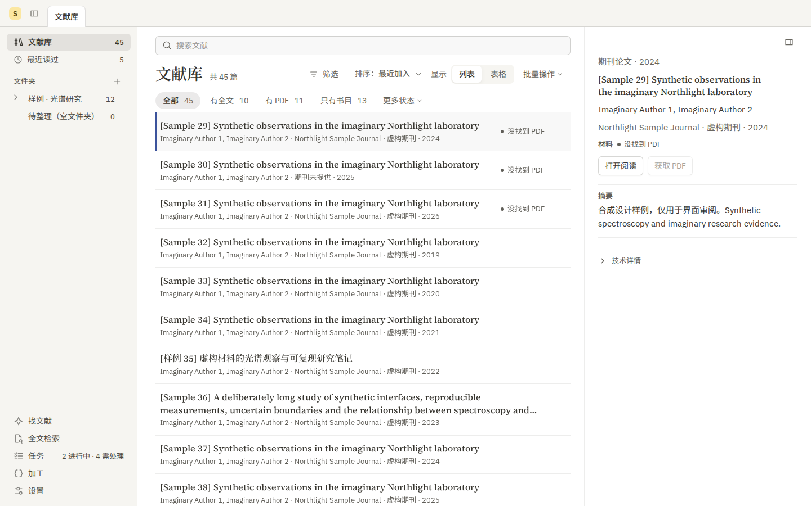
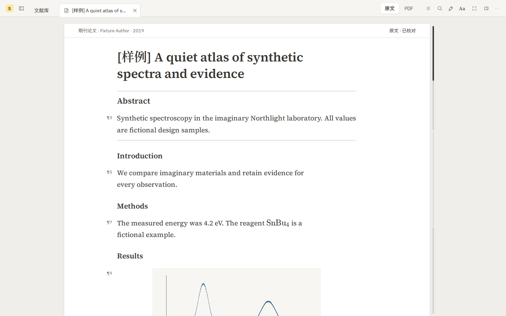

# SciRetriever

类型：指南
负责：产品入口、启动步骤与项目导航
状态：现行

SciRetriever 是通用的文献知识库。它把文献找来、把 PDF 取到、把 PDF 变成可检索、带出处的全文，让人和 Agent 都能从大量文献里得到可靠的知识，用于学习、写作和研究。不限领域。

- **找文献**：按主题检索多个书目来源，或从一篇文献沿参考文献、被引文献扩展。
- **导入**：拖入 PDF 或 BibTeX、RIS、CSL JSON 导出文件；用浏览器扩展从 Zotero 导入，或在网页上一键收藏。
- **获取 PDF**：按开放来源、授权接口、受控浏览器的顺序取 PDF，逐篇记录取得与没取得的原因。
- **生成全文**：解析 PDF，对照原文校订，得到分章节、带页码出处的全文。
- **阅读**：全文与 PDF 对照、批注、翻译、标签。
- **检索与加工**：全文检索；用可配置的算子做总结、问答标注、记录提取和多篇综合，结果都带证据。
- **给 Agent 用**：Web、CLI 和 MCP 共用一个文献库，桌面上的 Agent 可以直接检索、阅读和发起任务。





图中是合成的样例数据。

## 快速开始

需要 Linux x64、Node 22.19.0 和 pnpm（`corepack enable` 即可）。其他系统和 ARM 目前不支持，完整条件见[安装指南](docs/guides/installation.md)。

```bash
git clone https://github.com/LuckRookie/SciRetriever.git
cd SciRetriever
corepack enable
pnpm install --frozen-lockfile
pnpm build
pnpm sciretriever web --port 4174
```

启动后终端会打印访问地址和一个 `api_key`。用浏览器打开地址，把 `api_key` 粘贴到登录框，就进入文献库。第一次启动会在 `~/.sciretriever/` 下建一个空库，不需要先做任何配置。

不想自己装？把[给 AI 的配置提示词](docs/guides/setup-with-ai.md)交给 Claude Code、Codex 之类的编程 Agent，让它替你安装、启动和配置。

## 接下来

| 想做什么                               | 看哪里                                         |
| -------------------------------------- | ---------------------------------------------- |
| 从安装到读上第一篇，一步步走           | [上手指南](docs/guides/getting-started.md)     |
| 把已有的文献放进来                     | [导入文献](docs/guides/importing.md)           |
| 配置文献来源、解析服务和模型           | [配置手册](docs/guides/configuration.md)       |
| 了解 Web 界面每一页能做什么            | [Web 指南](docs/guides/web-workbench.md)       |
| 让自己电脑上的 Agent 连上文献库        | [Agent 接口](docs/guides/agent-interface.md)   |
| 在网页上收藏文献、从 Zotero 导入       | [浏览器扩展](docs/guides/browser-extension.md) |
| 其余功能（PDF 获取、建档、标签、加工） | [用户指南总目录](docs/guides/README.md)        |

## 现在的状态

项目还在快速迭代，用之前请知道这几件事：

- 只支持 Linux x64；Web 只走普通 HTTP，没有 HTTPS 和域名部署，请在可信网络里用，或经 SSH 端口映射访问。
- 找文献、导入、阅读已有 PDF 不需要配置。获取更多来源的 PDF、生成全文、翻译、标签和加工要先配置对应的来源、MinerU 解析服务或模型，见[上手指南](docs/guides/getting-started.md#哪些功能要先配置)。
- 生成全文、标签和加工的质量取决于你接入的解析服务和模型；平台保留来源与证据，不替代你对内容的判断。
- 库结构变化时，旧库不会被自动转换，升级前先看[初始化与恢复](docs/guides/upgrade.md)。

## 致谢

设计时研究并借鉴过下列项目的做法。SciRetriever 没有复制它们的代码；第三方许可与归属义务见 [NOTICE](NOTICE)。

| 项目                                                                                  | 借鉴了什么                                                                                                                    | 相关文档                                                                                                         |
| ------------------------------------------------------------------------------------- | ----------------------------------------------------------------------------------------------------------------------------- | ---------------------------------------------------------------------------------------------------------------- |
| [Mktero](https://github.com/tenglvjun/mktero)（MIT）                                  | MinerU 结果的规则整理：页眉页脚识别、按版面证据接断段、分栏阅读顺序纠正，以及按原文排版（章节顺序、标题层级、组图、脚注位置） | [ADR 0054](docs/architecture/decisions/0054-rule-preprocessing-and-source-order-layout.md)                       |
| [ScanSci PDF](https://github.com/Rimagination/scansci-pdf)（Apache-2.0）              | PDF 获取的候选发现方式与分阶段获取路径                                                                                        | [获取路径调研](docs/notes/pdf-acquisition-reference-paths.md)、[许可审计](docs/notes/scansci-migration-audit.md) |
| [Zotero](https://github.com/zotero/zotero)（“Find Available PDF”与 Zotero Connector） | PDF 发现、按站点的 Translator 与下载后验证                                                                                    | [获取路径调研](docs/notes/pdf-acquisition-reference-paths.md)                                                    |
| Zotero Full-Text Downloader（2026-08-03 本地快照，没有公开仓库）                      | 开放来源到浏览器的回退顺序与 PDF 校验                                                                                         | [获取路径调研](docs/notes/pdf-acquisition-reference-paths.md)                                                    |
| [TextFold](https://github.com/chenxiachan/textfold)（Apache-2.0）                     | 阅读页的做法：连续缩放、版面变化时固定阅读位置、就地展开回原文、用字体区分作者与机器的文字                                    | [ADR 0061](docs/architecture/decisions/0061-reading-first-reader-and-layered-reading.md)                         |

## 开发与贡献

仓库的目录分工和“要改什么去哪里”见[仓库目录地图](docs/development/repository-map.md)。开发、构建、预览和打包命令见[TypeScript 开发入口](docs/development/typescript-foundation.md)；协作约束见 [AGENTS.md](AGENTS.md)，工程与验收规则见 [HARNESS.md](HARNESS.md)。长期设计从[架构导航](docs/architecture/README.md)进入，文档的分类与归属见[文档导航](docs/README.md)。

反馈问题和提交改动的办法见[参与贡献](CONTRIBUTING.md)，安全问题见[安全说明](SECURITY.md)，各版本的变化见[更新记录](CHANGELOG.md)。

以 [MIT 协议](LICENSE)发布；随包分发的第三方程序的许可见 [NOTICE](NOTICE)。
