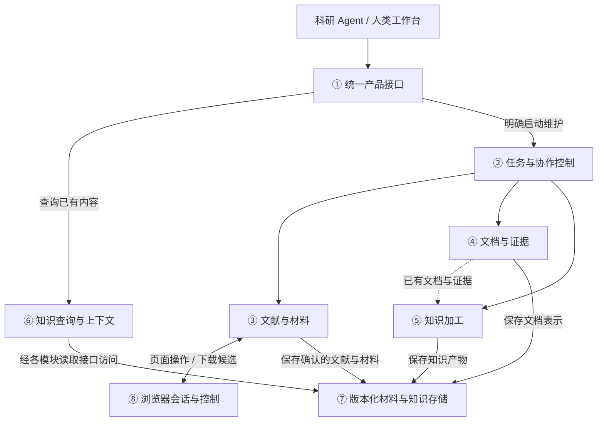

# SciRetriever 系统架构说明

> 本文说明项目要做成什么、各模块负责什么，以及它们怎样共同工作。这里描述的是目标架构，功能是否已经实现以源码和当前使用指南为准。

## 1. 项目做成之后是什么

SciRetriever 是科研 Agent 使用的文献与知识组件。它主要提供两种东西：**真实、可读取的原始论文材料，以及帮助理解大量文献的压缩知识。**

科研 Agent 可以从这里取得论文、查阅正文、读取总结，并沿着证据回到原文。需要批量提取实验数据时，外部 Agent 或程序可以使用同一套材料和证据接口，按照自己定义的记录结构提交提取候选；领域算法、科学判断和最终数据集由下游负责。

人类通过工作台配置系统、查看和指导浏览器获取论文，也可以搜索和阅读同一文献库。Agent 与人类使用同一套数据和业务服务。

使用方式分为两类：

| 用户想做的事                                                             | 系统如何响应                                               |
| ------------------------------------------------------------------------ | ---------------------------------------------------------- |
| **查询已有内容**：搜索文献、打开 PDF、查看已有总结、展开证据             | 读取库中已经存在的资料。缺什么就说明缺什么，操作到此结束。 |
| **明确启动维护**：增加元数据或 PDF，解析已有材料，生成分析，提交提取候选 | 在用户指定的范围内执行，并交付本次取得的材料或结果。       |

**查询不会自动变成搜索互联网、下载论文或生成总结的任务。** 每次扩充元数据或 PDF 都由用户明确开启；一次启动可以处理一批文献，任务内部不需要逐篇确认。发现元数据、获取 PDF 和加工材料可以分别启动，也可以按用户明确选择的步骤组合。

## 2. 整体结构：8 个顶层模块

下面始终按同一层级划分。文献管理、解析、分析等内部职责在所属模块内展开；界面、配置、网络和日志另行说明，不混入顶层模块的数量。

图中展示主要请求和数据关系。一次操作只调用所需模块：查询直接走读取路径；维护由任务模块协调；只有获取路线需要页面操作时才使用浏览器。提取候选可以直接交付下游，图中的存储箭头不表示系统默认托管全部候选。

这 8 个模块是理解和组织系统的职责划分。实现上继续采用同一个 TypeScript 应用、同一套逻辑文献库，各模块通过明确接口协作，不要求拆成 8 个独立服务。

## 3. 模块、子能力与责任

### ① 统一产品接口：把使用意图变成明确操作

这一模块是 Agent、命令行和工作台共同使用的入口。它提供文献查询、材料读取、发现、获取、解析、分析、提取交付和操作控制等能力，并说明每项操作需要什么输入、会产生什么影响、返回什么结果。

内部首先分为**查询入口**与**维护入口**。查询请求交给知识查询与上下文；维护请求交给任务与协作控制。不同界面的请求会转换成相同的产品操作，避免命令行、Web 和 Agent 各自实现一套业务逻辑。

它负责把请求说明白和把结果交付出去。是否接纳某篇文献、某份 PDF 或某个分析结果，由负责该事实的业务模块判断。

### ② 任务与协作控制：把一次明确的操作执行完整

这一模块负责一次维护操作的范围、步骤、预算、进度、取消和人工协作。例如用户要求获取选定的 20 篇论文，它先固定这 20 个目标，再安排获取，记录每篇的实际结果；执行中新增的其它论文不会自行加入。

内部包括**操作编排、执行控制、人工介入协调**。操作编排决定这次需要调用哪些业务能力；执行控制管理并发、预算和停止；人工介入协调把帮助请求与指导绑定到当前文章。具体页面控制权由浏览器模块执行。

它接收统一接口传来的维护请求，调用文献、文档或知识加工模块，最后汇总已完成、失败和未处理的部分。任务失败或取消后，已经成功保存的材料仍然保留。

上层科研 Agent 决定研究课题和研究策略；这里协调的是用户明确交给 SciRetriever 的文献操作。客户端关闭后是否继续运行、是否需要常驻后台，属于另行确定的运行方式。

### ③ 文献与材料：知道是哪篇论文，并取得它的原始资料

这一模块交付两类结果：**身份与来源清楚的文献记录，以及经过验收、能够读取的原始文件。** 内部有三个子模块：

- **元数据来源**：连接文献供应商，发现论文、查找书目信息、取得引用线索和下载线索。
- **文献管理**：判断来源记录对应哪篇论文、区分预印本与正式版、保留来源、管理统一元数据和书目引用关系，也负责书目导入导出。
- **材料获取**：利用已有线索，通过公开来源、获准 API 和必要的浏览器操作取得 PDF；也接收用户主动提供的文件。

文件下载结束后，材料获取还要检查实际 PDF 字节、可读性以及它是否属于目标文章，成功保存文件和文献关系后才算取得材料。网页链接、下载事件和文件扩展名都不能替代验收。

PDF 获取是本项目非常重要的能力，但它的职责止于交付可靠材料。材料一旦可用，文档、分析、提取和查询按各自需求使用它，不依赖下载路线或浏览器状态。已有库中的 PDF 和人工导入的 PDF 同样可以成为后续输入。

### ④ 文档与证据：让材料可读、可定位、可复核

这一模块把已有 PDF 变成方便程序和人阅读的正文、章节、表格或图片资源，并提供返回来源位置的证据引用。它可以独立使用，不需要先生成总结。

内部有两个子模块：

- **解析转换**：调用外部解析服务，检查转换结果，输出统一的文本和资源格式，使下游不必理解某个解析工具的私有协议。
- **文档与证据管理**：组织可读表示，提供有范围和大小限制的片段读取，管理表示版本与证据定位。

它从文献与材料取得明确版本的 PDF，向知识加工、查询和外部提取程序提供正文与证据。没有可靠页码、表格结构或坐标时，会说明能力不足；只拿到图片文件不等于已经读懂图中数值。

原始 PDF 本身也可以被读取和引用，不强制先解析。解析文档中的证据则绑定具体表示版本；以后重新解析，不会让旧引用悄悄指向另一段内容。

### ⑤ 知识加工：形成压缩知识，交付结构化提取候选

这一模块使用已有材料和证据，内部区分两种工作，因为它们的产物和验收责任不同。

**分析与综合**负责单篇概览、详细分析、针对问题的分析，以及指定文献集合的综合。它组织有界的局部分析与整合，保留结果的条件、局限、分歧和实际处理范围。同一篇论文可以有不同用途的分析，不能全部覆盖成一份含义不清的“最终总结”。

**提取交付**负责接收调用方的提取规范，绑定允许使用的材料，检查提交记录的结构、证据和输入版本，并交付候选与检查结果。记录是一项测量、一组实验还是跨文献组合，由调用方定义；具体提取算法在外部 Agent 或程序中执行，平台不尝试内置所有领域的算法。

两者共享材料和证据，但提取不依赖总结完成。分析产物由本模块验收并保存；提取候选可以直接交付下游。候选通过格式和证据检查，只说明通用完整性合格，科学合理性与最终数据集接纳仍由下游判断。

如果输入材料缺失，本模块返回缺口。它不会请求任务模块自行寻找或下载论文，也不会因为分析不适用、模型失败或提取零记录而删除原始 PDF。

### ⑥ 知识查询与上下文：把已有资料按需要交给使用者

这一模块接收查询问题、文献范围和返回预算，从已有元数据、文档和知识产物中查找内容。内部包括**检索与排序、版本与重复处理、上下文组装、证据展开**。

它通过各业务模块的读取接口取得事实，向 Agent 返回适合上下文预算的内容，向工作台提供可浏览的结果。原文与生成的总结会明确区分；结果携带来源、实际覆盖、截断信息和继续展开的入口。

例如某篇论文只有元数据，没有 PDF，它仍可以作为文献命中返回，同时说明缺少全文。没有某个问题的分析结果时，也只说明缺口，不启动模型。索引只是查找工具，可以重建，不能成为文献或知识的唯一副本。

### ⑦ 版本化材料与知识存储：可靠保存已经确认的事实

整个系统共用一套逻辑文献库。内部由**结构化目录**和**不可变文件存储**配合：目录保存身份、关系、版本、文件校验值和来源；文件存储保存 PDF、解析资源和知识产物等较大的内容。

业务模块决定保存什么：文献管理确认文献身份，材料获取确认 PDF，文档模块确认表示，知识加工确认产物。存储模块负责可靠地执行这些决定，使读取者看到完整、已经提交的结果。

原始材料和发布产物不原地覆盖。新结果产生新版本，默认展示哪一版另行管理；被有效知识引用的旧材料必须继续可读，或明确告知其失效。新结果失败时保留此前的有效结果。

这套存储为所有业务模块服务。一次任务的进度、日志或“完成”标志不能代替真实材料和产物是否存在、是否有效的判断。

### ⑧ 浏览器会话与控制：执行页面操作，支持人类协作

这一模块提供真实浏览器会话，负责页面观察、受控动作、下载捕获和控制权交接。材料获取在允许且需要的情况下调用它，取得下载候选后仍由材料获取模块验收。

内部区分**会话与页面、观察与动作、控制权与交接**。AI 和人类操作同一个生产会话；可以有多个观看者，但同一时刻只有一个动作控制者。

人类可以查看全过程、给当前文章指导、暂停、接管和交还。指导在安全的决策点消费，不等同于向网页输入框打字；交还后 AI 重新观察页面，接管前尚未执行的旧决定不能继续派发。已经发生的点击或下载按实际结果处理。

浏览器仅执行页面操作和交付候选，不决定文献身份、PDF 是否被接纳或总结是否正确。人类指导同样不能绕过文件验收与访问规则。

## 4. 用四个场景理解模块如何合作

### 场景一：Agent 查询库中已有知识

Agent 通过统一接口提交问题，知识查询模块查找已有文献、正文和总结，按预算返回相关片段及来源。Agent 可以继续展开证据，读取对应原文。

这条路径直接使用读取能力。没有命中或资料不足时返回缺口，不进入维护调度。是否扩充数据库，由用户另行决定。

### 场景二：用户收集论文，并在必要时帮助下载

用户先明确发起元数据发现。任务模块固定来源与范围，元数据子模块取得来源记录，文献管理确认身份并保存。**这一步结束时，新增的是文献记录，不会自动下载 PDF。**

用户再选择文献并启动 PDF 获取。任务模块把目标交给材料获取；获取模块按路线取得候选，需要页面操作时使用浏览器。遇到特殊情况，人类在同一会话中指导或接管。候选通过文件验收及当前任务关联检查后保存，标记文章身份未验证，原始材料即可读取；内容身份检验留待解析阶段（ADR 0029）。

用户也可以直接导入手上的 PDF，系统复制并验收材料，保留用户原文件。无论通过哪条路线取得，后续模块使用相同的材料接口。

### 场景三：用户分析已有论文

用户选择库中已有的 PDF，明确请求解析，文档模块交付可读正文与证据。这个结果本身就可以供人类或 Agent 阅读。

随后用户指定分析用途和输入范围，任务模块调用知识加工。分析模块读取固定版本的文档，组织模型分析与整合，校验证据和覆盖，再保存知识产物。之后通过普通查询即可反复读取，不需要每次重新生成。

如果用户明确选择“解析并分析”，两步可以组成一次加工操作。已有可读文档时直接使用；缺少 PDF 时报告缺口，不自动切入下载。某篇处理失败，不撤销其它已经完成的材料或结果。

### 场景四：下游从多篇文献提取实验数据

下游定义“一条记录是什么”、字段结构和提取方法，并选择已有材料。它通过文档与查询接口读取正文、表格上下文和资源，自行执行提取，再将候选记录及字段、关系证据交给提取交付子模块。

系统检查结构是否符合规范、证据能否定位到允许的输入、处理范围是否明确，返回候选和检查结果。下游再进行科学校验、领域去重和数据集接纳。

这条路径可以不配置内部分析模型，也不必先生成总结。零条记录与读取失败、未处理材料分别说明，不能都当成“论文没有报告数据”。

## 5. 人类工作台与共享支撑放在哪里

**人类工作台是统一产品接口的使用界面。** 它提供三个主要区域：项目配置、浏览器协作、文献与知识阅读。维护动作由用户明确发起，阅读则始终使用已有资料。界面复用现有 Web 基础，最终是否采用桌面或嵌入形式，不改变后面的业务模块。

支撑这些模块的公共技术能力单独管理：

| 共享支撑       | 服务整个系统的责任                                                             |
| -------------- | ------------------------------------------------------------------------------ |
| 配置与凭据     | 保存和校验设置，隔离密钥，说明保存后何时生效，执行用户明确要求的连接测试。     |
| 受控网络       | 为供应商、解析服务、模型和浏览器提供统一的访问、安全与限速规则。               |
| 模型运行时     | 执行一次模型调用，处理供应商协议、取消和稳定失败；分析步骤由知识加工模块组织。 |
| 公共合同与日志 | 合同统一模块间的输入输出；日志提供安全诊断，不代替业务结果。                   |

这些能力需要各自的技术实现和文档，但不会因此被重新算成一组顶层业务模块。生产组装负责连接它们，界面不复制配置规则，也不另外创建浏览器或文献库。

## 6. 所有模块共同遵守的规则

- **共享事实，责任唯一。** Agent 与人类读取同一套资料；每类业务事实由明确模块决定接纳，其它模块通过接口使用。
- **输入明确，来源可追溯。** 文献版本保守区分，原始来源保留；文档、分析和提取候选绑定具体输入，不能只凭论文标题判断来源。
- **材料独立可用。** 获取不以分析成功为条件，提取不以总结完成为条件。后续失败不能撤销此前有效提交。
- **证据跟随具体版本。** 重新解析或生成总结不会改写旧引用。证据可定位与科学解释正确分别判断；对外交付引用的保留和失效规则也必须明确。
- **范围和停止边界明确。** 操作只处理本次选定范围，取消后停止新工作，如实报告在途结果、已完成部分和未处理部分。

既有文献身份、文件校验值、来源、书目交换及受支持数据格式继续保留兼容要求。架构调整不授权静默迁移、覆盖或清理用户资料，也不以任务状态替代材料完整性。

质量应通过实际结果判断：PDF 真实可读且属于目标文章，知识能回到原文，长文和集合分析如实说明覆盖，查询不触发扩库，人工接管后旧动作不会误执行。模块数量和测试数量都不能代替这些结果。

## 7. 本文的范围

本文固定系统的职责层级、模块关系和使用流程。具体字段、接口、存储与并发细节在[技术文档](technical.md)中展开；产品依据见[需求文档](requirements.md)，长期决定见 ADR 0026–0028。

还需明确的产品选择包括：客户端关闭后的任务存续、最终人类界面形式、长期回放与允许的人工认证操作，以及候选托管和外部证据的保留期限。这些问题在对应能力落地前确定，不改变本文的模块划分。Zotero 深度集成暂不作为主要投入方向，已有书目交换继续保留。
