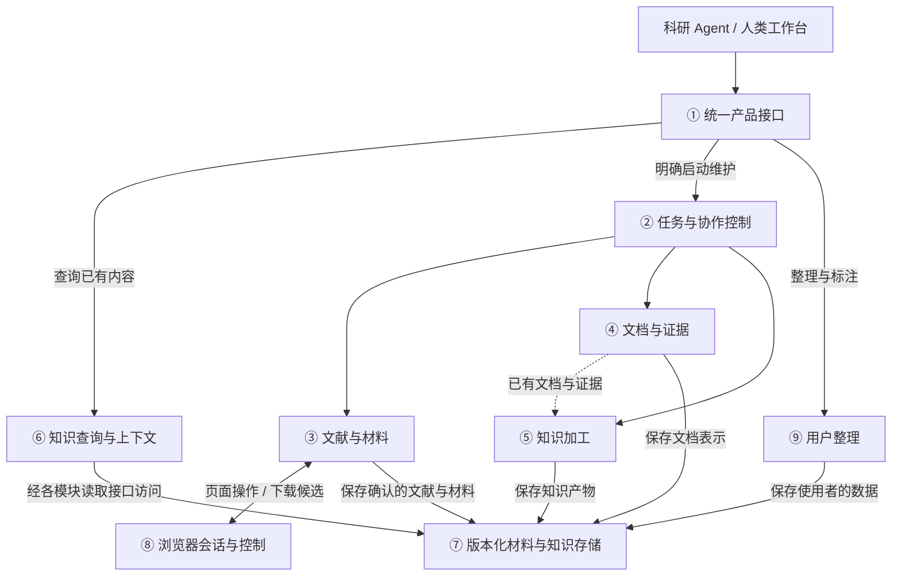

# SciRetriever 系统架构说明

类型：规格
负责：九个模块的责任与数据所有权
状态：现行

> 本文说明项目要做成什么、各模块负责什么，以及它们怎样共同工作。这里描述的是目标架构，功能是否已经实现以源码和当前使用指南为准。

## 1. 项目做成之后是什么

SciRetriever 是通用的文献知识库，服务人和 Agent 两类对象：研究者把它当作自己的文献库，科研 Agent 把它当作文献与知识组件（定位见[需求](requirements.md)第 1 节）。它主要提供两种东西：**真实、可读取的原始论文材料，以及帮助理解大量文献的压缩知识。**

产品要交付收、读、理、炼、用五件事，可靠是贯穿其中的品质，定义见[需求](requirements.md)第 1 节。本文第 2.1 节说明每件事由哪个模块负责。

科研 Agent 可以从这里取得论文、查阅正文、读取总结，并沿着证据回到原文。需要批量提取实验数据时，外部 Agent 或程序可以使用同一套材料和证据接口，按照自己定义的记录结构提交提取候选；领域算法、科学判断和最终数据集由下游负责。

人类通过独立完整的 Web 围绕文献库搜索、阅读、整理和执行操作，也可以配置系统、观看 Agent 的浏览器并自愿直接操作或指导。Agent 与人类使用同一套数据和业务服务；文献库是 Web 的主空间，任务与 Browser 服务于库内操作，不把产品固定为一条加工管线（[ADR 0032](decisions/0032-library-centered-web-workspace.md)）。

使用方式分为两类：

| 用户想做的事                                                             | 系统如何响应                                               |
| ------------------------------------------------------------------------ | ---------------------------------------------------------- |
| **查询已有内容**：搜索文献、打开 PDF、查看已有总结、展开证据             | 读取库中已经存在的资料。缺什么就说明缺什么，操作到此结束。 |
| **明确启动维护**：增加元数据或 PDF，解析已有材料，生成分析，提交提取候选 | 在用户指定的范围内执行，并交付本次取得的材料或结果。       |

**查询不会自动变成搜索互联网、下载论文或生成总结的任务。** 每次扩充元数据或 PDF 都由用户明确开启；一次启动可以处理一批文献，任务内部不需要逐篇确认。发现元数据、获取 PDF 和加工材料可以分别启动，也可以按用户明确选择的步骤组合。

## 2. 整体结构：9 个顶层模块

下面始终按同一层级划分。文献管理、解析、分析等内部职责在所属模块内展开；界面、配置、网络和日志另行说明，不混入顶层模块的数量。

图中展示主要请求和数据关系。一次操作只调用所需模块：查询直接走读取路径；维护由任务模块协调；只有获取路线需要页面操作时才使用浏览器。提取候选可以直接交付下游，图中的存储箭头不表示系统默认托管全部候选。

这 9 个模块是理解和组织系统的职责划分。实现上继续采用同一个 TypeScript 应用、同一套逻辑文献库，各模块通过明确接口协作，不要求拆成 9 个独立服务。

### 2.1 五件事落在哪些模块

每件事只有一个主要负责的模块。需求里的每个条目，由主要负责的模块回答“怎样做到”。

| 交付 | 主要负责                   | 协作                                                               |
| ---- | -------------------------- | ------------------------------------------------------------------ |
| 收   | ③ 文献与材料               | ② 协调成批操作；⑧ 在需要页面操作时取得全文；① 提供导入与收藏的入口 |
| 读   | ④ 文档与证据               | ① 的 Web 提供阅读器；⑦ 保存各版本的文本                            |
| 理   | ⑨ 用户整理                 | ③ 提供文献事实；① 提供界面与机器入口                               |
| 炼   | ⑤ 知识加工                 | ② 协调成批加工；④ 提供文本与证据                                   |
| 用   | ⑥ 知识查询与上下文         | ① 的三个入口交付结果，其中 Web 把加工结果呈现为人能直接阅读的页面  |
| 可靠 | 各模块对自己确认的事实负责 | ⑦ 保证已经确认的结果不被破坏；④ 保证证据能回到原文                 |

## 3. 模块、子能力与责任

### ① 统一产品接口：把使用意图变成明确操作

这一模块是 Agent、命令行和工作台共同使用的入口。它提供文献查询、材料读取、发现、获取、解析、分析、提取交付和操作控制等能力，并说明每项操作需要什么输入、会产生什么影响、返回什么结果。

内部首先分为**查询入口**与**维护入口**。查询请求交给知识查询与上下文；维护请求交给任务与协作控制。不同界面的请求会转换成相同的产品操作，避免命令行、Web 和 Agent 各自实现一套业务逻辑。

它负责把请求说明白和把结果交付出去。是否接纳某篇文献、某份 PDF 或某个分析结果，由负责该事实的业务模块判断。

### ② 任务与协作控制：把一次明确的操作执行完整

这一模块负责一次维护操作的范围、步骤、预算、进度、取消和人工协作。例如用户要求获取选定的 20 篇论文，它先固定这 20 个目标，再安排获取，记录每篇的实际结果；执行中新增的其它论文不会自行加入。

内部包括**操作编排、执行控制、人工介入协调**。操作编排决定这次需要调用哪些业务能力；执行控制管理并发、预算和停止；人工介入协调把帮助请求与指导绑定到当前文章。具体页面控制权由浏览器模块执行。

它接收统一接口传来的维护请求，调用文献、文档或知识加工模块，最后汇总已完成、失败和未处理的部分。任务失败或取消后，已经成功保存的材料仍然保留。

上层科研 Agent 决定研究课题和研究策略；这里协调的是用户明确交给 SciRetriever 的文献操作。客户端关闭后是否继续运行、是否需要常驻后台，属于另行确定的运行方式。

### ③ 文献与材料：知道是哪篇论文，并取得它的原始资料

这一模块交付两类结果：**身份与来源清楚的文献记录，以及经过验收、能够读取的原始文件。** 内部有三个子模块：

- **元数据来源**：连接文献供应商，发现论文、查找书目信息、取得引用线索和下载线索。
- **文献管理**：判断来源记录对应哪篇论文、区分预印本与正式版、保留来源、管理统一元数据和书目引用关系，也负责书目导入导出。
- **材料获取**：利用已有线索，通过公开来源、获准 API 和必要的浏览器操作取得 PDF；也接收用户主动提供的文件。

文件下载结束后，材料获取还要检查实际 PDF 字节、可读性以及它是否属于目标文章，成功保存文件和文献关系后才算取得材料。网页链接、下载事件和文件扩展名都不能替代验收。

PDF 获取是本项目非常重要的能力，但它的职责止于交付可靠材料。材料一旦可用，文档、分析、提取和查询按各自需求使用它，不依赖下载路线或浏览器状态。已有库中的 PDF 和人工导入的 PDF 同样可以成为后续输入。

### ④ 文档与证据：让材料可读、可定位、可复核

这一模块把已有 PDF 变成方便程序和人阅读的正文、章节、表格或图片资源，并提供返回来源位置的证据引用。它可以独立使用，不需要先生成总结。

内部有两个子模块：

- **解析转换**：调用外部解析服务，检查转换结果，输出统一的文本和资源格式，使下游不必理解某个解析工具的私有协议。
- **文档与证据管理**：组织可读表示，提供有范围和大小限制的片段读取，管理表示版本与证据定位。

它从文献与材料取得明确版本的 PDF，向知识加工、查询和外部提取程序提供正文与证据。没有可靠页码、表格结构或坐标时，会说明能力不足；只拿到图片文件不等于已经读懂图中数值。

原始 PDF 本身也可以被读取和引用，不强制先解析。解析文档中的证据则绑定具体表示版本；以后重新解析，不会让旧引用悄悄指向另一段内容。

### ⑤ 知识加工：形成压缩知识，交付结构化提取候选

这一模块使用已有材料和证据。Analysis 拥有可信处理器与通用结果接纳，Extraction 拥有外部规范与候选检查；默认处理器可消费提取合同，领域记录与最终数据集仍由调用方拥有。处理器输入、复用和持久化合同见[知识加工](technical/05-knowledge-processing.md)。

人和 Agent 都能发起加工，并取用同一份结果。加工结果既有供 Agent 读取的结构化形式，也有供人阅读的页面；页面由统一产品接口的 Web 呈现。

**分析与综合**负责单篇概览、详细分析、针对问题的分析，以及指定文献集合的综合。它组织有界的局部分析与整合，保留结果的条件、局限、分歧和实际处理范围。同一篇论文可以有不同用途的分析，不能全部覆盖成一份含义不清的“最终总结”。

**提取交付**负责接收调用方的提取规范，绑定允许使用的材料，检查提交记录的结构、证据和输入版本，并交付候选与检查结果。记录是一项测量、一组实验还是跨文献组合，由调用方定义；调用方可以在外部 Agent 或程序中执行，也可使用 ADR 0034 的通用默认提取处理器；领域算法和科学接纳规则仍由调用方决定。

两者共享材料和证据，但提取不依赖总结完成。分析产物由本模块验收并保存；提取候选可以直接交付下游。候选通过格式和证据检查，只说明通用完整性合格，科学合理性与最终数据集接纳仍由下游判断。

如果输入材料缺失，本模块返回缺口。它不会请求任务模块自行寻找或下载论文，也不会因为分析不适用、模型失败或提取零记录而删除原始 PDF。

### ⑥ 知识查询与上下文：把已有资料按需要交给使用者

这一模块接收查询问题、文献范围和返回预算，从已有元数据、文档和知识产物中查找内容。内部包括**检索与排序、版本与重复处理、上下文组装、证据展开**。

它通过各业务模块的读取接口取得事实，向 Agent 返回适合上下文预算的内容，向工作台提供可浏览的结果。原文与生成的总结会明确区分；结果携带来源、实际覆盖、截断信息和继续展开的入口。

例如某篇论文只有元数据，没有 PDF，它仍可以作为文献命中返回，同时说明缺少全文。没有某个问题的分析结果时，也只说明缺口，不启动模型。索引只是查找工具，可以重建，不能成为文献或知识的唯一副本。

### ⑦ 版本化材料与知识存储：可靠保存已经确认的事实

整个系统共用一套逻辑文献库。内部由**结构化目录**和**不可变文件存储**配合：目录保存身份、关系、版本、文件校验值和来源；文件存储保存 PDF、解析资源和知识产物等较大的内容。

业务模块决定保存什么：文献管理确认文献身份，材料获取确认 PDF，文档模块确认表示，知识加工确认产物。存储模块负责可靠地执行这些决定，使读取者看到完整、已经提交的结果。

原始材料和发布产物不原地覆盖。新结果产生新版本，默认展示哪一版另行管理；被有效知识引用的旧材料必须继续可读，或明确告知其失效。新结果失败时保留此前的有效结果。

这套存储为所有业务模块服务。一次任务的进度、日志或“完成”标志不能代替真实材料和产物是否存在、是否有效的判断。

### ⑧ 浏览器会话与控制：执行页面操作，支持人类协作

这一模块提供真实浏览器会话，负责页面观察、受控动作、下载捕获和控制权交接。材料获取在允许且需要的情况下调用它，取得下载候选后仍由材料获取模块验收。

内部区分**会话与页面、观察与动作、控制权与交接**。AI 和人类操作同一个生产会话；可以有多个观看者，但同一时刻只有一个动作控制者。

人类可以查看全过程，自愿给当前文章指导或直接在画面中点击、输入。直接操作先完成服务端控制权交接与页面版本校验，再执行输入；界面显示实际控制者并提供交还。指导在安全的决策点消费，不等同于向网页输入框打字；交还后 AI 重新观察页面，接管前尚未执行的旧决定不能继续派发。已经发生的点击或下载按实际结果处理。无人介入时自动获取按自身结果结束，人工协作不是必经阶段；离开画面与断线后的恢复细节仍需单独设计。

浏览器仅执行页面操作和交付候选，不决定文献身份、PDF 是否被接纳或总结是否正确。人类指导同样不能绕过文件验收与访问规则。

### ⑨ 用户整理：让使用者按自己的方式组织和标注文献

这一模块负责使用者对文献的组织和标注：**分组、保存的筛选条件、批注和笔记**。使用者把文献库当作自己的文献库来用，靠的是这一模块（[ADR 0059](decisions/0059-general-literature-knowledge-base.md) 第 4 节）。

这些内容是使用者自己的数据，不是文献事实。分组和批注不改变文献的身份、书目信息和材料；一篇文献是谁、有哪些来源、全文是哪份文件，仍由文献与材料决定。标签的归属不变，由建档和标签词表管理。

它从文献与材料取得文献，从文档与证据取得批注所指向的位置，向查询提供“按分组筛选”这类条件，向三个入口提供读取和修改。从外部文献管理工具带入的分组和批注也落在这里。Agent 在同等授权下可以读取这些数据。

使用者的数据稳定保存，可以导出。文本更新后，批注能定位就继续指向原来的内容；不能定位时如实说明，不悄悄指向别处。

将来人和 Agent 自己产出的知识进入知识库时，也从这一模块进入，方向见[需求](requirements.md)第 6 节。

## 4. 跨模块工作流

查询、材料准备、人工协作、分析与提取的完整组合场景见[知识服务工作流](knowledge-service-workflows.md)。本篇只定义模块责任与依赖。

## 5. 人类工作台与共享支撑放在哪里

**Web 是以文献库为中心、为人设计的独立完整入口**（[ADR 0032](decisions/0032-library-centered-web-workspace.md)、[ADR 0038](decisions/0038-web-design-basis.md)）。信息架构与页面排布见[页面规格](web/page-specs.md)；日常加工与阅读服务各自形成完整体验，具体实现范围以指南、源码与测试为准。

用户围绕单篇、选中项或明确筛选范围发起获取、解析、分析、标签、记录提取、综合和导出；入库与人工补 PDF 具有明确入口。读取和写入可以在同一库界面组织，但写操作显式提交，查询与阅读不触发加工。Web 复用 ADR 0034 的处理器应用边界，提供问题、记录含义和字段配置、结果集合与字段查询、证据核对、结果再次加工及导出；普通失败、配置补全和显式重试也应在 Web 内完成，不以底层 JSON 代替人类操作流程。

阅读兼顾连续阅读与带问题核查。PDF 导航、查找、缩放，解析全文的结构与资源，多文献位置保留，以及从结论或提取字段往返原文都是基础阅读目标；字号、行宽和侧栏等服务于阅读舒适度。文档、结果和证据的读取仍由原 owner 提供，Web 组织呈现，不伪造材料能力或定位。阅读器的具体布局、实现和偏好保存另行设计；批注、笔记等持久保存的内容由用户整理模块负责，不能作为 UI 状态绕过业务边界。

按 [ADR 0033](decisions/0033-machine-interfaces-cover-web-capabilities.md)，CLI 与 MCP 分别覆盖 Web 的可调用业务能力，无需复制阅读器、证据高亮或对照布局等视觉交互。Web 无需展示全部维护命令；数据库迁移、损坏修复、底层诊断及特殊操作可留在 CLI 或受控机器入口，低层提取交付、索引维护和原始请求保留高级入口。三端复用同一 Application/Entry 与业务 owner，通过稳定引用衔接。

材料状态不压成单一线性完成度；保存视图是查询条件的复用概念，不因此新增 Collection 或把所有导入都当作持久批次。数据边界以 ADR 0032 为准。

支撑这些模块的公共技术能力单独管理：

| 共享支撑              | 服务整个系统的责任                                                                                                                                                                                     |
| --------------------- | ------------------------------------------------------------------------------------------------------------------------------------------------------------------------------------------------------ |
| 配置与凭据            | 保存和校验设置，隔离密钥，说明保存后何时生效，执行用户明确要求的连接测试。                                                                                                                             |
| 受控网络              | 为供应商、解析服务、模型和浏览器提供统一的访问、安全与限速规则。                                                                                                                                       |
| 模型与 Agent 执行基础 | 按 [ADR 0031](decisions/0031-dsh-backed-agent-capabilities.md)，唯一 DSH/Cordis 底座承接单次调用、会话、工具循环与上下文压缩；项目适配统一模型绑定、协议、取消和稳定失败，业务工具与结果仍归消费模块。 |
| 公共合同与日志        | 合同统一模块间的输入输出；日志提供安全诊断，不代替业务结果。                                                                                                                                           |

这些能力需要各自的技术实现和文档，但不会因此被重新算成一组顶层业务模块。生产组装负责连接它们，界面不复制配置规则，也不另外创建浏览器或文献库。

## 6. 所有模块共同遵守的规则

跨模块不变量与审查依据统一见[架构原则](principles.md)，产品验收见[需求](requirements.md#7-验收)。

## 7. 本文的范围

本文固定模块关系和事实所有权；产品目标见[需求](requirements.md)，字段、接口、存储与并发见[技术文档](technical.md)，Web 设计见[Web 规格](web/README.md)。各项实现和验收状态由[用户指南](../guides/README.md)与[活动计划](../plans/README.md)提供。
