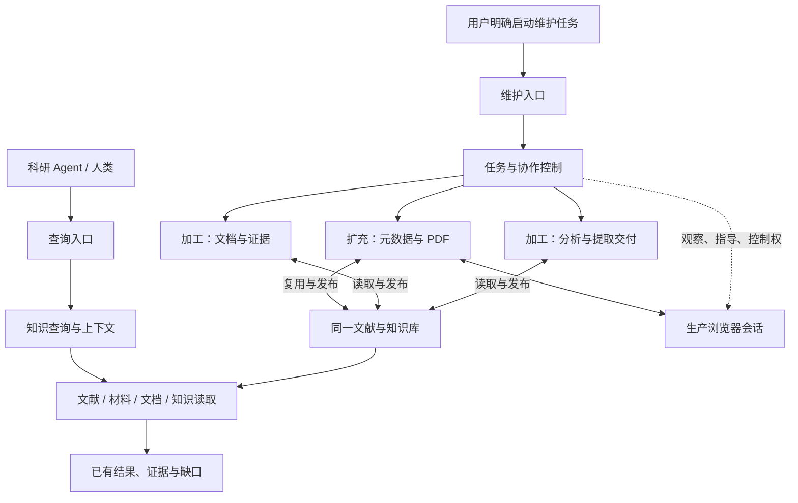

# 知识服务工作流

类型：规格
负责：跨模块工作流与组合示例
状态：现行

本文说明能力组合与失败后的交付边界；模块责任见[架构设计](design.md)，具体任务和运行存续合同见[任务协调](technical/02-task-coordination.md)。

## 0. 已确认目标与本方案的关系

完整目标是材料供给、文档处理、分析/总结、通用提取、查询与人类协作。PDF 有效获取的重要性很高，必须有实际文件与文章归属验收；这不意味着其他模块围绕下载运行状态设计。分析和提取以已有合适材料为前提，材料可以来自自动获取、人工导入或既有库。

模块职责已由 ADR 0026/0027 确认，本文把它们展开为建议流程；精确协作合同和实现取舍见[统一产品接口：共享合同、结构解析与版本兼容](technical/01-product-interface.md#6-共享合同结构解析与版本兼容)。图的布局与实施先后都不代表某个模块统领全系统。

查询与扩充的启动边界由 [ADR 0028](decisions/0028-query-and-expansion-separation.md)确认确定；以下分别展示读取和显式维护路径。

## 1. 这张图表达哪些责任

查询结果中的缺口没有通向维护调度的自动边。人类可以根据缺口另行启动维护，也可以明确指示 Agent 代为发起具体任务；普通 Agent 查询不能自行开启扩库。配置仍归 Configuration，图中只突出文献/知识的读写边界。

图中的箭头说明调用与交付；源码依赖和生产组装由技术文档规定。

图中各模块的责任与当前代码映射分别见[设计](design.md#3-模块子能力与责任)和[TypeScript 模块地图](typescript-baseline.md)。

R 与 T 通向 B 的含义不同：R 拥有文章获取目标、页面策略与候选验收；T 拥有操作生命周期、指导及控制权协调；B 执行经当前控制权和页面绑定校验的动作。二者不能成为竞争点击同一页面的控制器。

K 是逻辑能力组：Analysis 生成解释/压缩，Extraction 管规范绑定、候选检查与交付。外部提取策略通过 API 消费 D/Q 的读取能力并提交候选，不默认上传到 K 内运行。S 不是允许各模块直接写 SQL 的入口，产物由业务 owner 验收、Storage 执行发布。

## 2. 只读取已有材料与知识

1. Agent 或人类声明查询、文献范围、所需内容类型和返回预算。
2. API 交 Q 检索；需要正文/资源时通过 D 的有界读取合同取得相应版本。
3. Q 返回命中、知识或上下文，以及来源、证据和继续展开的入口；实际覆盖与截断明确。
4. 缺少全文、可读表示或所需分析时如实返回缺口；不创建 Job、不自动排队、不调用维护。可以返回尚未执行的后续操作建议，扩充由用户另行明确开启，新生成也需显式加工请求。

这条路径不要求先创建处理任务或调用 LLM。已经发布的产物可以按稳定引用直接读取；若检索索引异步更新，应说明索引覆盖/新鲜度，不能将旧索引未命中解释成产物不存在。

## 3. 为明确范围准备知识

查询和维护分别发起，共享结果，但不自动互相调用：

1. **查询已有内容。** Agent 或人类请求库内检索/读取，得到材料与知识以及缺口。请求到这里结束，不因缺 PDF/总结就建立任务。
2. **用户另行启动扩充。** 需要更多论文时明确启动元数据发现/补充/导入；需要全文时明确启动 PDF 获取或人工接纳。仅启动发现不会自动下载全文；一次有界批量操作内部仍可以自动工作。
3. **维护复用已有事实。** T 只在本次已启动的操作与范围内检查缺口，R 执行该任务的来源访问、获取与验收，发布成功即可交付原始材料。
4. **明确启动已有材料加工。** 原始解析、建档和算子分别显式发起；建档产生校订稿及就绪档案，单篇算子读取固定校订稿。外部提取器使用读取/提交能力交付候选；缺材料时返回缺口。
5. **验收和发布。** 各 owner 校验输入/证据/规格并发布自己的产物；用途和版本不同不能冒充可互换结果。局部失败保留已提交材料及知识。
6. **再次查询。** 后续查询可以读取新提交的结果；它不会自动追赶未完成的维护任务或生成新任务。

具体可提交操作见[Agent 接口指南](../guides/agent-interface.md)；获取、解析、建档之间不自动衔接。

已启动的批量维护仍按具体材料/产物推进：早提交的 PDF 可进入该维护命令已声明的后续步骤，不必等待其它目标。请求重发重读事实，但查询结果本身不重发维护；发布去重不承诺外部调用恰好一次或绝无重复计费。

## 4. 获取受阻时的人类协作

本节是可选协作路径，不是每次获取受阻后的必经工作流。按 [ADR 0032](decisions/0032-library-centered-web-workspace.md)，无人观看或帮助时自动获取仍按真实结果结束；正常耗尽与临时失败分开报告，用户可稍后从对应文献主动补充 PDF。

1. R 的文章流程通过 T/B 暴露当前文章、会话、真实进展及可用交互方式；有活会话时，人可以自愿进入 Agent 操作界面。
2. 工作台通过 API 观看真实页面、动作结果和控制状态；观看不暂停 Agent。直接点击/输入触发控制权申请，也可提交绑定当前文章的指导。
3. T 协调控制权变化。指导在安全决策点交给 R 的控制器；接管使未派发的旧决定失效。已经派发的动作及其 capture 结果按实际目标处理，不能假装撤回。
4. 服务端确认控制权及当前页面绑定后，人类在同一 B 中完成允许的操作并交还；过期输入不重放到新页面，AI 从新的页面/控制版本重新观察，不重放接管前决定。
5. 捕获文件仍由 R 做 PDF 字节/可读性与任务关联检查，进入统一材料发布流程；按 ADR 0029 初始标记文章身份未验证，内容身份核验留待解析，不要求普遍的人工候选审核。

独立的解析、模型分析和其它不依赖该会话的工作可以继续。共享同一独占 Browser 资源的文章仍可能等待，不能以任务拆分承诺浏览器无限并行。主动介入后的等待/停止遵守控制协议，不标成正常自动获取耗尽；离开画面不默认等于交还，当前断线政策见 [Browser 技术文档](technical/08-browser-control.md#45-断线多观察者与介入等待)。

配置请求直接交 Configuration owner；凭据和 Browser 权限不由任务状态或自由指导文本授予。外部提取器的取消和 usage 需协议协作，本系统只能控制自身能力调用，不能声称终止了任意外部程序或验证了未观测的模型执行。

## 5. 局部失败、中断与任务恢复的区别

| 发生什么                 | 必须保持的结果                                       |
| ------------------------ | ---------------------------------------------------- |
| 单篇获取失败             | 该篇后续依赖准确停下，其它可推进工作继续             |
| 解析失败                 | 原始资产保留，可单独重试解析                         |
| 分析失败或提取候选被拒绝 | 材料和已有有效知识保留，不补默认数据伪造完成         |
| 人类正在处理一个会话     | 当前会话控制互斥；其它资源按实际约束调度             |
| 用户取消                 | 停止新工作，对在途工作按实际结果收尾，已接纳产物保留 |
| 服务进程崩溃             | 已提交事实仍可读取；新请求根据这些事实补齐缺口       |

持久任务的显式恢复、取消和进程关闭行为见[任务协调](technical/02-task-coordination.md#10-已有材料加工任务)。

## 7. 用具体场景检验模块独立性

| 场景                       | 主流程与终点                                                                     | 失败/变化检验                                                                        |
| -------------------------- | -------------------------------------------------------------------------------- | ------------------------------------------------------------------------------------ |
| W01 只有文献标识，只要 PDF | 明确启动元数据接纳（若未入库）；另行明确启动 PDF 维护 → C03 → C12 → 原始文件读取 | 已有资产复用；文件损坏、错误文章、权限失败分别处理；下载事件或 HTTP 成功不算交付成功 |
| W02 已有 PDF，独立解析     | C04 → C05；返回正文、结构和资源，不执行 Analysis                                 | parser 失败保留 PDF；部分解析说明覆盖；无模型配置仍能读取                            |
| W03 获取时人工介入         | C03 的生产 B → C11 观察/指导/接管 → 新观察继续 → 原获取验收                      | 接管前迟到决定被拒绝；在途 capture 如实归属；无人响应不伪装自动耗尽                  |
| W04 已有材料，单篇分析     | C05 → C06 → C12；按用途返回知识产物                                              | 模型失败保留材料；改问题得到不同规格产物；无获取能力也可处理已有材料                 |
| W05 指定集合综合           | 固定 InputManifest → 有界单篇/局部处理 → 按问题整合 → 产物与证据                 | 缺一篇时按请求选择严格等待或明确部分综合；不得暗称完整领域共识                       |
| W06 外部提取器自行提取     | C07 绑定规范 → C05/C09 读取/检索 → 外部策略 → C08 候选交付                       | 一文多条/跨文/嵌套均可；不依赖先有摘要或内部模型；零记录与读取失败有别               |
| W07 只查已有材料/总结      | C09 → 必要的 C05 展开，或直接按产物引用读取                                      | 空检索与索引故障有别；缺口不下载、不生成、不创建补库任务                             |
| W08 批量取消或输入变化     | T 停止新派发；各 owner 结算已开始工作；重发请求读事实                            | 已提交产物保留；具体旧版本可读与“最新默认结果”分开；新结果不得错绑新输入             |

W09 配置变更：人类通过 C10 读取/编辑配置 → 由 Configuration 校验并发布 → 显式 probe 使用相应已发布配置 → 向用户说明新操作与在途操作的生效范围。保存后立即 probe、冲突编辑、撤销权限与在途请求分别验证；是否长期保存普通参数快照仍按具体任务合同决定。probe 不构造文献存储，不证明特定文章已可下载。

### 7.1 综合并不隐藏额外科研判断

例如请求对 100 篇指定文献比较方法，有 80 篇已可读、20 篇缺材料。系统说明缺口，按已明确的部分处理政策分析现有 80 篇，或返回前置不足。这个比较请求不会下载其余 20 篇；需要补齐时，用户另行启动 PDF 维护，完成后再发起加工。Analysis 不能把 80 篇说成全部 100 篇。这里的数量只是场景输入，不是性能指标。

Analysis 可以消费已存在且规格匹配的分析产物，但综合的 lineage 仍要能追溯原始材料；引用摘要时标明引用的是解释，不能把多次摘要当作多个独立原始证据。获取模块不需要知道这次比较使用了什么问题或模型。

### 7.2 提取记录由调用方定义

例如调用方规定“一条记录为同一样品的一组不同温度测量”，外部程序先读取方法、表格、脚注和相关段落，再提交嵌套记录。平台核对规范版本、字段路径及证据是否属于本次输入；它不把一篇论文强制拆成一条记录，也不据标题相同合并样品。

另一领域换成“一条记录是一项研究的方法与评估设置”，应只改变调用方规范与策略，材料读取和候选交付协议继续成立。字段分别有证据不等于它们属于同一个实验；关系证据和领域判断由调用方规则完成。平台通用检查通过后，候选仍须由下游决定能否进入数据集。

### 7.3 推演结论与待验证内容

上述场景在设计层能落到明确 owner、输入、交付与失败，没有要求每次经过整条链；获取/分析、Analysis/Extraction 之间也没有反向控制依赖。这些场景规定验收意图，不是具体版本的通过声明。真实获取成功率、知识质量和人工介入效果必须另以代表性场景及实际证据验证。
