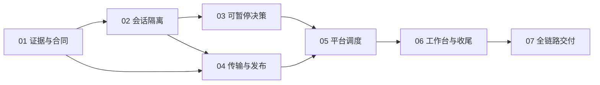

# Browser 独立 worker 与后台下载实施计划

> 归档记录（2026-10-08）：用户追加授权归档已完成计划并分块提交。最终代码集成点为 `2ccab0a`；Provider 迁移为 `0e6c1da`，共享 Network 为 `fcdeda1`。下文保留实施期间的授权范围与验收记录，其中“未执行 Git 写操作”描述当时状态。归档时复核 456 个源码、测试及依赖文件，与最近通过 Full 的版本完全一致。

> - **Run ID**：`browser-parallel-downloads-20261005`
> - **状态**：Completed；2026-10-07最终Full与Browser验收完成。23个原样本跨轮20个正式成功，3个外部访问条件未满足，详见验收记录。
> - **创建 / 更新**：2026-10-05 / 2026-10-07
> - **计划基线**：`dd2df24` 加已有 Browser/PDF 修复工作树；不是干净提交
> - **当前分支**：本次文档重写时为 `master`；实施开始时重新记录 branch、worktree、HEAD 和 patch 范围
> - **Primary owner**：Codex负责审核与集成；用户已授权GPT-6.1-sol / max执行者按边界协作，Claude Code Opus是前轮方案讨论
> - **本轮范围**：用户已要求完成整份计划；执行关键适配、合同、实现与完整验收，保留已有工作树

## 目标与已确定方向

元数据进入 Browser 兜底后，多个独立 worker 可以推进不同平台的文章。每篇有明确的页面、操作预算和下载归属；
下载开始后暂停该篇模型决策，原会话继续支持后台传输，空闲 worker 处理其它文章。
有效 PDF 通过正式 acceptance/publication 入库并标为文章身份未验证；下载或文件验收失败时，原会话携带失败原因和剩余预算恢复。

实现仍使用一个持久 Cloak process/context/Profile，worker 不通信、不互相委派。队列、平台限制和资源状态由进程内 owner 维护，
不引入外部消息系统、分布式调度或新的 Literature 状态。公开 URL/API 仍是更低成本的优先路径，Browser 页面策略保持通用。

用户明确要求和当前实施起点分别为：

| 项目       | 本计划采用的语义                                                      | 来源 / 确认位置                                    |
| ---------- | --------------------------------------------------------------------- | -------------------------------------------------- |
| 动作节奏   | 动作结束到下一轮模型决策至少5秒，与页面反馈等待重叠计时               | 用户要求；Task 3.2                                 |
| 单篇预算   | 300秒累计活跃时间，50次真实模型派发，100次Agent动作；恢复不清零       | 用户要求；Tasks 3.1、3.3                           |
| 独立worker | 初始2个，服从现有共享模型并发2的预算                                  | 两轮讨论建议；Task 5.4                             |
| 文章会话   | 复用现有cap，默认5；一个会话最多管理一个主下载                        | 两轮讨论建议；Tasks 2.1、4.1、5.5                  |
| 平台访问   | 同平台浏览或下载只允许一篇；网络活动结束后冷却30秒                    | 用户要求的冷却在本方案中的具体解释；Tasks 1.5、5.2 |
| 下载恢复   | 保留原页面，传输或文件检查失败后重新观察；publication失败保留有效文件 | 用户要求；Tasks 3.4、4.7、6.2                      |
| 大文件     | 全链路落盘/分块处理，不再由16MiB或512MiB常量决定能否取得材料          | 用户要求；Block 04                                 |

2个worker、资源保护值及配置兼容方式是开工方案，不冒充已经通过性能验收的最佳参数。
Accepted ADR 0023、0030及相关中性合同已由[Block 01](01-baseline-and-runtime-contracts.md)同步新会话/worker语义；当前交付以实现与验收证据为准。
计划不自行改写架构权威，也不把前轮代码或真实测试算作新并行实现的完成证据。

## 真相源、范围和非目标

产品与数据边界见[requirements](../../architecture/requirements.md)、[design](../../architecture/design.md)、
[technical](../../architecture/technical.md)及[材料获取技术合同](../../architecture/technical/03-literature-materials.md)。
适用决策包括 [ADR 0012](../../architecture/decisions/0012-process-local-provider-access-scheduling.md)、
[ADR 0023](../../architecture/decisions/0023-generic-browser-agent-executor.md)、
[ADR 0029](../../architecture/decisions/0029-unverified-pdf-acquisition.md)、
[ADR 0030](../../architecture/decisions/0030-browser-transport-and-progress.md)。
工程验证与交付遵守 [HARNESS](../../../HARNESS.md)。

覆盖 Entry 调度、Browser会话/输入/传输、Acquisition验收、Storage大文件路径、共享平台政策、配置兼容、
工作台选择/人工接管、取消/停服和授权范围内的真实Browser复测。

不顺带增加出版社选择器、worker聊天、外部验证码服务、自动切换账号/IP/Profile、跨进程限速、
活浏览器现场的崩溃后恢复、断点续传、新核心模块或新的文献数据库状态；不重新实现元数据/API自动获取全链路。
RSC系统DNS问题由管理员处理，本计划不修改服务器网络。

## 跨块不变量与责任

- **任务归属**：文献/operation generation → article session → page/popup → transfer → candidate固定关联；前台标签页不是归属证据。
- **独立执行**：worker只有一轮执行权，不拥有文章事实；等待和下载不占模型槽，迟到动作不能在新阶段执行。
- **访问政策**：换worker、标签页、入口或重试不能清零平台冷却、窗口或Retry-After；不能用每30秒加载一项CSS替代文章级限制。
- **文件事实**：原始字节、hash、provenance、metadata CAS与create-if-absent保留；不恢复正文身份匹配门槛，不覆盖已发布资产。
- **生命周期**：暂停决策不等于关闭页面；取消A不取消B，关闭A不等待B；共享context只有整体owner关闭。
- **结果语义**：无权限、连接失败、资源不足、限流、预算耗尽与文件损坏分别报告，均不能伪装为已证明没有PDF。
- **配置兼容**：旧支持配置继续读取，显式收紧项真实执行；新生效并发不静默忽略已有串行意图。
- **最小结构**：现有模块维护运行内存状态，不新增持久队列、Agent互通协议或另一套业务写入者。

| owner                        | 唯一职责                                         | 不承担的职责                           |
| ---------------------------- | ------------------------------------------------ | -------------------------------------- |
| Entry / BrowserSessionBroker | 会话调度、资源资格、最终操作结果与acceptance交接 | 不解析PDF正文、不模拟浏览器网络        |
| Browser                      | 页面归属、观察/动作、原生传输与进度、会话资源    | 不决定文献事实、不按出版社写动作程序   |
| Network                      | URL/DNS/连接准入及共享访问政策执行               | 不将CDN/验证服务自动当成全部文章的平台 |
| Acquisition / Literature     | 文件接纳、当前输入复检、publication及文献关联    | 不把点击或下载事件当作入库             |
| Storage                      | 受控句柄、分块文件、hash与不可变发布             | 不决定目标文章或下载重试               |
| Workbench                    | 有会话身份的观看、指导和控制权                   | 不维护另一套Agent时钟、候选或调度状态  |

## 结果块与实际依赖

本次按七个可交接结果拆分，数量来自当前工作，不是后续计划的固定模板。Task的具体输入、输出和断言在所属文件。
依赖允许合同层先行。用户本轮已明确授权派遣GPT-6.1-sol / max；主执行者按文件边界分工、审查并顺序集成。
初批为1.2导航归属探针、1.3取流探针、1.4–1.6合同/ADR，生产共享接口需集成者确认后再分别实施。

| 块  | 结果                                                                    | 前置                                | 后续交接                                        | 状态      |
| --- | ----------------------------------------------------------------------- | ----------------------------------- | ----------------------------------------------- | --------- |
| 01  | [基线、关键适配与运行合同](01-baseline-and-runtime-contracts.md)        | 当前工作树与已确定方向              | 经验证的归属/取流能力、owner合同、ADR与错误语义 | Completed |
| 02  | [按文章隔离的浏览器会话](02-session-ownership-and-browser-isolation.md) | 1.2、1.4–1.6                        | 后台页/弹窗正确归属、局部settle与输入边界       | Completed |
| 03  | [可暂停的Agent循环与时间预算](03-agent-pacing-and-suspension.md)        | 02；1.5、1.6                        | 单步可恢复会话、5秒节奏、累计预算与转移事件     | Completed |
| 04  | [后台传输、大文件与正式发布](04-background-download-and-publication.md) | 1.3、1.5、02；与03对接事件          | 无整文件内存瓶颈的候选/入库、可靠传输终态       | Completed |
| 05  | [跨平台调度与配置兼容](05-platform-scheduling-and-configuration.md)     | 02、03、04的事件/资源合同及直接测试 | 真正并发、平台冷却/公平、共享限流与有效配置     | Completed |
| 06  | [工作台、恢复、取消与停服](06-workbench-recovery-and-shutdown.md)       | 02–05已接入生产对象图               | 人工操作隔离、异常恢复和完整资源收尾            | Completed |
| 07  | [全链路验证与交付](07-end-to-end-verification-and-handoff.md)           | 02–06退出条件                       | Full、真实Cloak隔离链、授权真实站点及最终交接   | Completed |

03使用04约定的事件形状完成局部状态测试，04不等待03完整实现才做文件链；05负责把两者接成真实并行。
这种依赖不允许把只有fixture通过的块声称为端到端完成，也不以内部状态拆出额外业务模块。

## 开工基线与验收方向

下表是开工时确认的旧生产结构及本轮验收方向，不能继续当作当前源码状态。
当前已接通的对象图、真实证据和剩余缺口见下方“当前进度、恢复点与下一安全动作”及所属块。

| 当前证据                                                          | 位置                                                                        | 本计划仍要证明什么                       |
| ----------------------------------------------------------------- | --------------------------------------------------------------------------- | ---------------------------------------- |
| 全局Promise tail、host单个articleActive                           | `entry/pdf-acquisition.ts`、`browser/production-host.ts`                    | 多会话实际推进，而非只提高配置数字       |
| activePageId兼有前台、请求准入与归属作用                          | `browser/host.ts`                                                           | 新页/后台页/弹窗归属在请求发出前确定     |
| 单个Intake target、pending candidate和flow holder                 | `bootstrap/application.ts`                                                  | A/B迟到事件与取消不会串线                |
| 传输30秒deadline、response.body整块读取，started/failed未完整接线 | `browser/transfers.ts`、bootstrap                                           | 单项下载进度和独立传输生命周期           |
| 16MiB Intake、512MiB多层限制、接纳/发布重复整块读取               | Acquisition、collector、Storage、contracts                                  | 超旧边界文件全链路可用且内存有界         |
| FileStore和SqliteWorker共用写入admission                          | `bootstrap/application.ts`、`storage/files/`                                | 大文件准备不长时间堵住其它catalog写入    |
| 平台政策字段存在，但生产Browser调度没有消费                       | configuration、Entry                                                        | 旧配置与新政策一起执行、可解释且可验证   |
| 前轮串行真实样本与Full记录                                        | 通用修复记录（本地文件：`sandbox/reports/browser-generic-repair-validation-2026-10-05.md`，不随仓库分发） | 不能替代新对象图、并行、恢复或大文件证据 |

两轮 `claude --print --model opus` 讨论已完成，运行报告为 `claude-opus-5-5`。
讨论原始记录位于 `/tmp/sciretriever-browser-parallel-plan-m7huoumy/`，关键取舍已分配到01和各结果块，
不依赖该临时目录长期存在。当前新Cloak导航探针已连续3轮通过，取流探针7项通过；证据进入01。

## 主要风险与负责块

| 风险                         | 具体失败                                     | 负责块     |
| ---------------------------- | -------------------------------------------- | ---------- |
| 重定向/popup早于可用归属证据 | 先访问出版社后限速，或等待自身产生的事件死锁 | 01、02、05 |
| 保留页面后台发请求           | 释放平台资格后仍绕过冷却                     | 02、04、05 |
| 当前任务/全局settle残留      | A文件关联B，或取消A等待B的大文件             | 02、06     |
| 多套墙钟与共享signal         | 排队/下载误耗300秒，取消模型时切断下载       | 03、06     |
| 只改文件入口而未改验收/发布  | GB级材料内存上涨、共享写锁长时间阻塞         | 04、07     |
| 同平台任务占满会话           | 其它平台有worker却无法启动                   | 05         |
| 配置以前无效、现在直接生效   | 大并发旧值打开过多页面，旧串行意图丢失       | 05         |
| 一个工作台投影映射多会话     | 人工指令误发到别篇、预算被人工操作重置       | 06         |

## 授权、验证与完成口径

本轮用户已明确授权派遣GPT-6.1-sol / max执行完整计划，由Codex审核和集成。此前已授权的真实模型/出版社测试继续限于隔离home/Profile/catalog和当前服务器网络，
不复制个人Cookie，不读取配置或凭据原文；实际调用由配置/凭据owner完成。计划不新增系统DNS、真实Library迁移、
用户资产清理、账号切换、Git提交/推送/PR或发布权限。需要破坏受支持合同或改写真实数据时仍先处理相应授权与迁移策略。

块内先用相关Vitest和失败注入验证；真实Cloak访问本机合成服务证明浏览器行为，真实出版社结果另记，不混在离线Harness里。
代码交付必须通过 `pnpm full`。具体已有测试入口、需新增的场景及真实测试结果表见各块；未执行命令不作为通过证据。

计划完成至少同时满足：

- 两个不同平台的模型决策能重叠，另一篇可后台下载；相同平台串行与30秒冷却跨worker成立。
- 5秒节奏与300/50/100预算使用唯一会话状态，下载和排队不误占活跃时间。
- 文件从浏览器事件到正式入库归属正确，取消、恢复、重复和迟到事件不破坏其它文章。
- 大于16MiB及跨512MiB的有效合成PDF通过完整链路；进度、磁盘、峰值内存和写锁范围有证据。
- 工作台可选择/接管准确会话；共享context健康退出，没有被报告成功却仍占用的传输/文件责任。
- 原配置、Public/API/manual-PDF、已有资产/回执/标签合同保持兼容；必要ADR和当前指南已同步。
- Full、所需实际Cloak场景和集成审查闭环，真实网站的外部限制与代码缺陷分别列明。

不能用“所有出版社都成功”作无法解释的单一指标，也不能把DNS/429挡住的样本标为通过；
任何明确的内部归属、传输、恢复缺陷仍回到负责块修复。受外部环境阻断的现场项有原因与重试条件，不能被悄悄勾选。

## 最终验收与交接（2026-10-07）

01–07全部任务已收口。最终Full：189文件/1,266项通过，15文件/39项按原环境条件跳过，build通过，exit0。
最终源码/测试/依赖清单142项，hash55a59148dcabd9d2a8345d8b4c9b689831b92307bcc6f04e1bab726306fc0c01；
HEAD仍dd2df24，工作树未提交，原有无关改动保留。

真实模型qiuzk/gpt-6-luna、同一Cloak context/Profile、默认2 worker/5保留会话，给定真实元数据后走正式Browser链。
原23个样本完整矩阵及定点复验共20个PDF正式入库、受验证导出hash一致；这是一组跨轮证据，不是23篇同一最终hash的全成功声明。
最后生产源码的IEEE/AMS各3次模型派发成功，全部Scheduler与文件资源计数0。
RSC仍受系统DNS EAI_AGAIN阻断；Elsevier的指定旧文献、World Scientific样本显示具体内容不在订阅内。
IEEE中间一次零模型generic异常缺少raw cause，后续成功不被当成旧失败根因已查明；诊断限制如实保留。

最终文档切换实际Cloak12/12、17MiB原响应到正式导出通过；正式App popup/显式串行、取消/停服、513MiB、
实际30/60秒访问政策、配置兼容与安装入口按影响审计结合已有证据验收。
下载/网络事实由通用owner维护，本轮没有新增出版社选择器或URL模式补丁。
Full另发现旧并发测试未隔离DOI下载，已用既有离线端口修复fixture；未修改生产或延长timeout。

完整逐样本、版本、命令、skip、审查与资源证据见最终验收记录（本地文件：`sandbox/reports/browser-final-acceptance-2026-10-07.md`，不随仓库分发）。
计划完成不包含Git提交/发布、系统DNS修复、真实catalog迁移、个人Cookie使用或新的真实Public/API/解析验收。

## 2026-10-05暂停时的历史恢复记录

**2026-10-07 已按用户要求恢复。** 以下表格为暂停时基线，新增验收单独记录。 并行会话、后台下载、大文件、平台冷却、工作台与取消/停服均已接通；
本轮最后修复的是旧文档普通 Script/XHR 和明确 Fetch 失败响应的终态缺失。
暂停时源码与针对性证据已核对一致；当前继续必要修复、真实出版社复测和最终 Full。

| 已有证据           | 范围与限制                                                                                                     |
| ------------------ | -------------------------------------------------------------------------------------------------------------- |
| 生产并行与后台下载 | 实际 App+Cloak 三平台，两路模型 HTTP 重叠，第三篇慢下载；分别正式发布/导出，见03–05                            |
| 动作与预算         | 5.1秒反馈实际入库；5秒派发间隔及300/50/100累计预算，恢复不清零，见03                                           |
| 大文件             | 17 MiB及513 MiB真实传输、验收、发布与导出；混合负载及资源计量，见04/07                                         |
| 平台与用户控制     | 真实30秒/429退避、候选取消、模型故障、共享失联与正常退出，见05/06                                              |
| 最后局部修复       | 6文件62项直接回归通过；6项普通实际Cloak回归通过，keepalive保护/owned-close另定点1项通过；最新Quick通过         |
| 最近一次Full       | 修复前构建188文件/1,202项通过，14文件/37项环境跳过，build通过；不能替代最后bug修复的Full                       |
| 真实出版社         | 跨批累计19/23正式入库且导出hash一致；ACS挑战页、RSC429、World登录/预算、Elsevier内部导航失败均保留，见验证记录 |

最后的真实Cloak保护用例确认：keepalive在EOF前仍登记、socket仍开、B未访问；明确取消后真实target销毁，
Scheduler四项与文件额度全0。它**不证明**旧文档keepalive在EOF后能自动跨站；部分此类请求仍缺可观察终态，
程序保守等待。失败现场 `sciretriever-document-handoff-seAkpN` 保留，不能把该限制写成已修复。
真实Elsevier最后仍是修复前的内部导航失败；旧XHR究竟属于普通XHR还是Fetch，原运行缺少类型证据，
修复后未再运行真实站点，不能声明该篇成功。

源码/测试/依赖冻结清单：`/tmp/sciretriever-browser-parallel-implementation-v9ay8y23/paused-bugfix-source-manifest.json`，
139项，SHA256 `f5da200ecfa9dfd18e7471df09de7301ffa6a64736caa903c952c98777b535ba`。
本轮保留已有dirty工作树，未Git提交、改系统DNS、迁移真实catalog或清理用户资产。

暂停时记录的恢复动作（现已由上方当前收口取代）：

1. 决定并验证keepalive缺少终态的处理边界，不能凭EOF时间或删除请求表伪造网络结束。
2. 用冻结构建定点验证Elsevier及受影响真实路径，沿用真实模型`qiuzk/gpt-6-luna`，区分内部问题与外部限制。
3. 运行最终Full并完成07集中验收；更新真实矩阵、最终patch与各块退出条件后才可标整计划Completed。

详细新旧证据和每篇结果见本轮验证记录（本地文件：`sandbox/reports/browser-parallel-validation-2026-10-05.md`，不随仓库分发）。
当前原计划任务保留，不用已通过的局部回归代替未执行的最终验收；本轮依据用户恢复指令继续上述工作。

## 变更与最终交接

- 2026-10-05：用户确认独立worker并行、后台下载、平台冷却与大文件方向；Codex和Claude Code Opus完成两轮讨论。
  收敛为单进程、共享Profile、2个worker、默认5个会话、每会话一个主下载。
- 2026-10-05：用户指出上一版只有方案概述，要求参照Sci-Flow计划写法；本次改为根控制面与七个结果块，
  增加稳定Task、真实依赖、失败注入、退出条件和交接，不改变已讨论的产品目标，也不要求后续计划固定七块。
- 本轮文档验收记录见07的“计划编写证据”，不勾选07的代码交付Tasks。

完成、取消或替代时记录最终revision/patch、实际检查、未完成现场项及其归属；
长期决定和已交付行为进入ADR/technical/guide。按仓库既有约定处理历史计划，Git交付和发布不随计划完成自动发生。

- 2026-10-05：用户授权GPT-6.1-sol / max并行执行，Codex审核与集成。首批执行者分别拥有新导航探针、新下载探针和合同/ADR范围；不得互改生产共享文件。基线通过不代表新方案完成。

- 2026-10-07：用户要求继续完成最终全链路验收，恢复 In progress；保持既有授权边界和已有工作树。

- 2026-10-07：最终Full exit0与Browser实际验收收口，01–07标记Completed；外部访问条件和历史诊断限制保留在最终报告。

[上级目录](../README.md) · [项目 README](../../../README.md)
