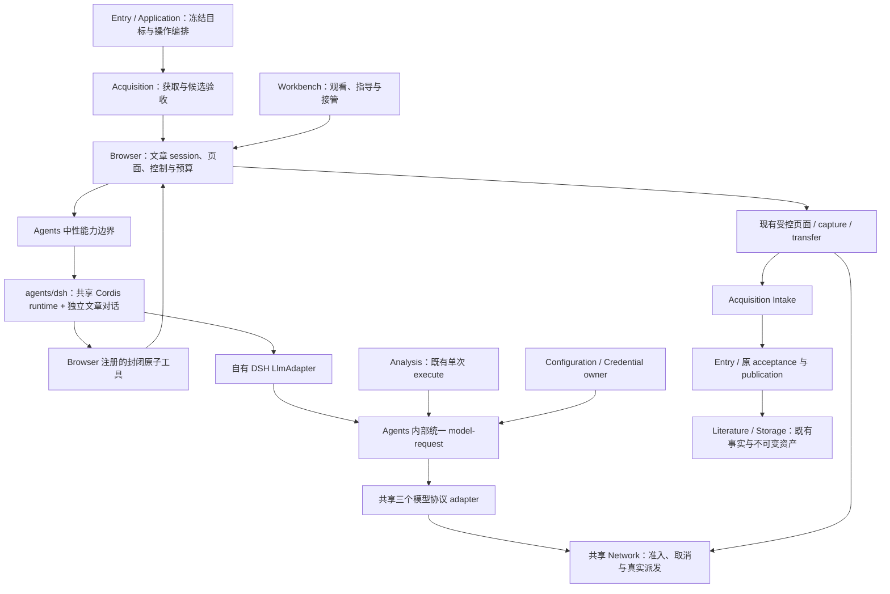
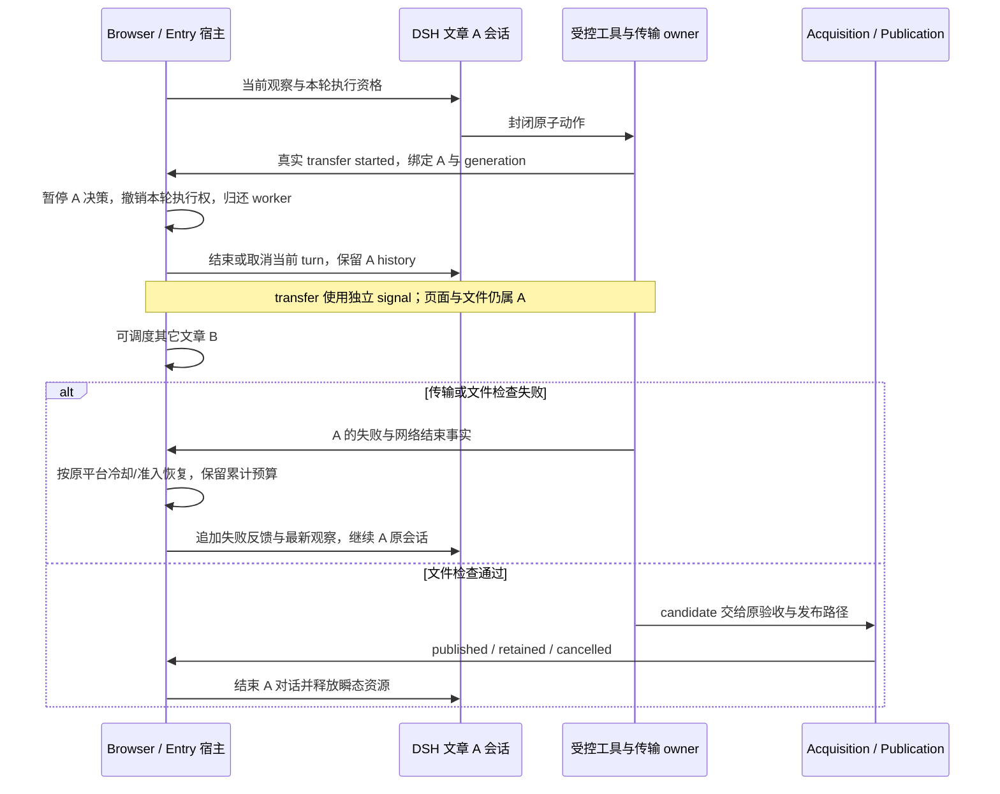

+++
document_type = "proposal"
status = "accepted"
created = "2026-10-13"
+++

# DSH Agent 后端接入提案

Owner 已决定采用 DeepSeek Harness（DSH）作为 Agent 执行基础，放弃 Pi Agents 选型路线。长期决定见 [ADR 0031](../../architecture/decisions/0031-dsh-backed-agent-capabilities.md)，先前的框架比较见[归档讨论](../2026-10-13-agent-runtime-options/proposal.md)。本提案只审阅 DSH 的具体接入方式，不继续进行 Pi 对照选型。

**归档状态：Accepted，首期实施 Completed（2026-10-13）。** Owner 已批准具体方案并完成实施。下文保留方案形成时的设计与当时基线；实际完成范围、测试与性能限制以实施记录为准，不把历史拟议措辞当作当前状态。执行拆分见[实施计划](README.md)，计划状态不能代替批准或验收。

## 1. 目标与首期范围

首期用 DSH 接管 Browser Agent 的通用模型—工具循环、完整对话历史和可选上下文压缩，使文章多轮探索、人工指导、下载失败恢复能够沿同一段历史继续。Browser、Acquisition、Entry、Network 和 Configuration 继续持有各自业务决定；模型不获得浏览器原始控制权或文献事实写入权。

业务调用方使用有明确输入、结果、执行状态和产物引用的中性 Agent 能力，内部才连接 DSH。先交付 Browser 这一项完整能力切片，不预先建设通用工作流框架、动态插件平台或任意 prompt API。数据提取、图片提取可以以后复用执行基础，但本期不实现提取算法、不定义领域记录 schema，也不改变 [ADR 0027](../../architecture/decisions/0027-extraction-capabilities-and-caller-defined-records.md) 的调用方所有权。

预期改进首先是可验证的历史完整性与责任收敛：下一次模型请求能看到先前调用、真实结果和恢复原因，项目不再维护第二套通用模型循环。下载成功率、耗时、缓存命中及维护成本的改善，需要后续证据，不能由选型决定直接推导。

## 2. 当前行为与拟议变化

截至 2026-10-13，当前 [article-flow.ts](../../../apps/server/src/browser/article-flow.ts) 驱动观察—模型—动作；[decision.ts](../../../apps/server/src/browser/decision.ts) 每次用目标、当前观察和截图、近期动作与即时反馈重建 system/user。它没有贯穿整个文章任务的完整工具调用及结果会话。

[AgentCall/AgentMessage/AgentResult](../../../apps/server/src/agents/protocol.ts) 只表达 system/user/assistant 和单个结构化结果或工具调用；[AgentRuntime.execute](../../../apps/server/src/agents/runtime.ts) 是共享单次执行入口。这些类型和运行时已经通过 [server index](../../../apps/server/src/index.ts) 导出。三种协议为 OpenAI Chat Completions、OpenAI Responses、Anthropic Messages，均使用当前配置、凭据 owner 和 Network。

| 方面         | 当前实现                             | 拟议首期                                                                    |
| ------------ | ------------------------------------ | --------------------------------------------------------------------------- |
| 模型循环     | Browser 自行逐轮调用单次 Runtime     | DSH 推进模型—工具循环；宿主逐次授予执行资格                                 |
| 模型上下文   | 当前观察、截图和有界近期反馈         | 同篇连续 history，保留 assistant 调用与对应 tool result，再追加新观察及指导 |
| 文章业务状态 | Browser session、clock、控制 epoch   | 仍由原 owner 决定；DSH session 只保存执行上下文                             |
| 模型请求     | 单次公开合同，经三个协议 adapter     | 保留公开合同；Agents 内部增加完整请求/响应表达，共享同一组协议与 Network    |
| 历史压缩     | 无通用会话压缩                       | 经验证后按需挂载；使用同一模型出口和文章预算                                |
| 调用方       | Browser 决策函数直接依赖单次 Runtime | Browser 能力边界接收中性输入，返回宿主已确认的状态/结果引用                 |
| 持久化       | 既有操作、候选、文献及资产事实       | 不新增 DSH 持久日志、数据库 schema 或跨进程会话恢复承诺                     |

当前已具备文章隔离、后台传输、Web 观看/指导/接管、共享平台准入、5 秒节奏和累计预算。这些是接入后必须保留的行为，不能列为 DSH 新增成果。

## 3. 进程内对象图与模块边界

建议在当前 Node 进程内，由 Bootstrap 构造一份共享的 DSH/Cordis 运行环境；Browser 为每篇文章创建独立的对话与 Agent scope。Cordis 只用于 `agents/dsh/` 的内部服务组装，不把 SciRetriever 各业务模块改写成 Cordis 插件。



| 落点                            | 拟议职责与边界                                                                                              |
| ------------------------------- | ----------------------------------------------------------------------------------------------------------- |
| `agents/dsh/`（拟新增私有目录） | DSH/Cordis 组装、session/Agent 生命周期、history/事件转换、附件桥和 `LlmAdapter`；vendor 类型不进入业务接口 |
| `agents/` 既有模型实现          | 内部完整 model-request、三个协议 adapter、能力/响应检查、取消和稳定失败；兼容已有公开单次 `execute`         |
| `browser/`                      | 工具定义、提示词中的 Browser 任务语义、文章/页面身份、观察版本、控制 epoch、活跃计时、动作节奏及结果解释    |
| `entry/`、`application/`        | 操作范围、就绪队列与 worker、宿主编排、取消及对外进度；不以 DSH idle 代替操作完成                           |
| `acquisition/`                  | 文件检查、候选接纳/排除和发布交接；模型“完成”不构成下载成功                                                 |
| `network/`                      | 所有真实外部请求的唯一共享准入、配额、冷却和取消；不增加 Agent 专用限流器                                   |
| `configuration/`、`bootstrap/`  | 沿用 Provider/Model 选择、凭据、reasoning/image/stream 和 readiness，组装一次共享对象图                     |
| `analysis/`                     | 保留既有 prompt、处理步骤、schema 与业务验收；不因 Browser 引入 DSH 而强制改为工具会话                      |

DSH scope/session 是瞬态执行上下文，不是文章 session 的第二个业务状态机。DSH 可以报告运行、空闲、取消或失败，只有宿主能裁决文章当前是否可继续、候选是否可交付、操作是否完成。

## 4. 最小 DSH 服务组合与依赖策略

已调查版本的官方 `agent-loop` 测试展示：直接 `new Context()`，加载 `LlmRuntime`、`SessionStore`、`SessionProjectionRegistry`、`SystemPrompt`、`ToolRuntime`、`AgentRegistry`、`AgentLoop` 七个基础服务即可组装循环。首期从这一组合验证；需要压缩时再加入 TokenMeter 与压缩服务，需要图片时提供宿主可控的 AttachmentStore。

这里描述的是运行时服务集合，不是 npm 包数量或最终 lockfile。具体发布包、peer/传递依赖、版本组合和 Node 22.19.0 兼容性必须在批准后的离线验收中核对；锁定版本后记录许可与升级边界，不能混用不同提交的接口。

不启动 DSH 默认 CLI、SDK server、ACP、Web 服务或代理，不加载 shell、文件系统工具、内置 Browser provider、个人 home/settings、系统环境自动发现或默认模型插件。模型与工具均由宿主显式注入，既有 SciRetriever 配置仍是唯一配置来源。选用 DSH 不要求使用 DeepSeek 模型，也不依赖其默认 `pi-ai` 模型插件。

压缩是可选能力，首期必须验证其可插拔和请求归属。是否默认启用、何时触发、保留多少近期图文，留在批准后的最小接入验证中依据模型窗口与离线证据定稿，不先引入用户可调的庞大参数表。

## 5. 能力入口与工具接口草图

以下只表达责任与信息流，**不是已冻结的导出 TypeScript API、配置 schema、MCP 或新的持久化合同**。最终命名应围绕 Browser 生产调用方收敛；不因一份示例提前创建通用注册中心。

```ts
// 模块边界草图；实际输入和结果应引用既有中性合同。
interface AgentCapability<Input, Output, ArtifactRef> {
  execute(
    input: Input,
    context: CapabilityContext,
  ): Promise<{
    status: CapabilityStatus;
    output?: Output;
    artifacts: readonly ArtifactRef[];
  }>;
}

interface CapabilityContext {
  signal: AbortSignal;
  // 宿主注入受控工具、逐次派发资格和状态通知。
  // 不携带 DSH 对象、原始 Browser handle、凭据或数据库写入能力。
}
```

Browser 能力的输入绑定已有 operation/generation、article/session identity、冻结目标和控制范围；内部通过受控读取取得当前观察。输出表达真实执行结局与脱敏失败信息，产物引用只指向原 owner 已确认并允许交接的候选或已发布结果，不把临时截图、DSH 日志或自然语言陈述当作文献产物。中途等待、人工接管和后台下载通过宿主已有生命周期投影，不为示例新增持久状态表。

Browser 工具仍按现有六种动作提供封闭原子能力：`ClickElement`、`ClickPoint`、`ScrollSurface`、`GoBack`、`WaitForChange`、`Stop`。工具定义和安全校验归 Browser；DSH adapter 只负责注册和协议转换。观察读取可作为内部受控接点，动作结果由 Browser 附上真实反馈与新观察，不能借工具化增加任意 URL、selector、JavaScript、文本输入、Page/Context/CDP、Cookie、文件系统或发布权限。

每次动作都由宿主检查当前 article/page/surface/revision、控制 epoch 和派发资格。模型的多工具响应不扩大 Browser 的权限：一轮决策仍最多执行一个页面动作，额外调用、过期调用和已经失权的调用形成明确的拒绝结果回到 history，不能静默丢弃，也不能顺序执行一批依据旧截图生成的动作。停止原因继续遵守现有 Browser 合同。

## 6. 完整历史、模型协议与统一真实派发

### 6.1 历史要保留可追溯的调用与结果

DSH 保存文章初始目标、assistant 文本/工具调用、对应 call ID、工具成功或失败结果、后续观察以及人工指导。工具没有执行、已被取消或因版本过期拒绝时，也要产生正确归属的终结结果；重试前可以分辨“曾执行失败”与“未执行”。不得再逐轮只发送新的 system/user 加最近若干条动作，把 DSH 当成包装现有单次决策的外壳。

页面内容和人工指导都是受约束输入，不能覆盖系统权限。新观察由 Browser 生成，保留当前版本；模型能记住旧观察，不意味着旧 element ID、坐标或页面权限仍然有效。发生接管、导航、下载失败等变化时，将确定性事实追加到原会话，再根据最新观察继续。

### 6.2 保留公开单次合同，共享内部完整协议

当前 `AgentCall` 的 role 和 `AgentResult` 单结果合同不足以表达完整工具对话；直接把 DSH history 塞进它，或通过向业务方暴露 DSH 类型解决，都会破坏边界。

拟议在 `agents/` 内提炼中性 model-request/response 层，至少能表达有序文本/图片、assistant 多个工具调用、call ID 对应的工具结果、自由文本结束及 usage。DSH 私有 `LlmAdapter` 将其会话投影转换到这一层；既有 `AgentRuntime.execute` 通过兼容投影继续接受原 `AgentCall`、返回原 `AgentResult`。旧单次调用仍按原合同拒绝不合法响应，不静默挑选多工具结果中的第一项。

OpenAI Chat/Responses/Anthropic 的编码、流式/非流式解码、reasoning、工具 schema、图片和 usage 在现有 adapter 体系内完善。DSH 与 Analysis 共享这些实现，不在 `agents/dsh/` 重写第二套 HTTP/wire，也不借 DSH 默认 Provider 建立旁路。内部结构不立即向包外导出；若发现必须改变受支持的公开合同，再单独提交兼容方案。

### 6.3 预算绑定真实发送，而不是 run/turn

当前 Browser 的 `onDispatched` 对一次 decision 只允许调用一次。DSH 一段 turn 可能包含多次普通模型调用、摘要调用及失败恢复，因此不能复用这一个计数闭包覆盖整段会话。

建议由宿主为每次实际模型请求提供新的 lifecycle，始终关联原 article/session/operation 与控制代次；请求走同一 Network transport，在真实发送前复检权限并递增文章调用数。普通循环和压缩必须经过同一出口，DSH 的普通循环 hook 不能成为唯一计量点，因为压缩可能直接调用共享 LLM service。

- Browser 保持单篇累计 300 秒活跃时间、30 次真实模型派发，以及动作结束至下一轮决策至少 5 秒。模型/平台排队、人工接管、后台下载和本地验收/发布继续按原规则排除活跃计时。
- 压缩消耗模型请求，因此与普通推理共享该文章剩余派发数；压缩时的实际推理纳入同一活跃计时。摘要没有额外额度，不因新 turn、新 worker、失败恢复或重建 scope 重置预算。
- 第 30 次合法请求的结果仍按原规则结算；若它是压缩请求，不能据此放行第 31 次决策。时间、控制版本和已启动传输的独立寿命继续生效。
- 不启用绕过宿主的自动重试、格式切换、后台保温或隐式摘要重试。以后确需重试，也必须显式取得原文章剩余资格并在真实发送时计数。
- Analysis 既有单次调用继续使用自身调用合同，共享 Network 但不附加 Browser 的 300 秒/30 次业务预算。

配置继续按 [ADR 0021](../../architecture/decisions/0021-provider-model-registry-and-direct-task-selection.md) 精确传递 Provider/Model、reasoning/image/stream，不按模型名称猜测或降级。取消、无权限、限流、响应不完整和工具协议错误应转换为稳定失败，保留原因，不能冒充正常无 PDF。

## 7. 首期会话策略、缓存与资源寿命

**拟议首版：一个共享 runtime，每篇文章一个独立的长期对话。** “长期”指该文章在当前操作中的完整寿命，包括多轮工具调用、下载挂起和失败后恢复，不承诺跨进程保留。文章 A 后台下载时可以推进文章 B；恢复 A 仍使用 A 的 history、身份和剩余预算。

三种复用分别验证：

| 复用对象     | 首期建议                              | 含义与限制                                         |
| ------------ | ------------------------------------- | -------------------------------------------------- |
| 运行环境     | 同进程共享 Cordis、LLM 与工具基础服务 | 避免每篇重建依赖图；不共享文章业务状态             |
| 会话上下文   | 同篇跨 turn 连续；文章间隔离          | 保留完整试探和失败原因，减少归属污染               |
| 模型服务缓存 | 稳定 system/工具定义及可复用前缀      | 是否命中、缓存计费和支持范围取决于服务，不保证收益 |

连续跨篇 batch conversation 留作后续独立方案，首期不要求实现；它需要另外解决文章切换、旧页面引用、下载 A/B 交错恢复、上下文污染和保留策略。也不通过每篇重建 runtime 来替代会话隔离。

图片通过宿主附件桥绑定文章与观察版本。模型仅获得允许的截图内容，不能凭引用任意读取路径；附件不能包含未遮罩敏感输入或暴露临时下载 query。上传给模型的图片字节与业务 artifact 引用分别处理。

DSH 压缩改变的是模型可见投影，不保证删除原始 append-only history 和截图。首期采用操作内的有界资源生命周期：文章挂起时保留恢复所需的 history 与附件；已结束且结果完成交接后，注销监听器、关闭 scope、释放会话和附件；整体关闭先停止派发、结清在途，再释放共享服务。仅由新投影不再引用某张图，不能证明原始记录不再持有它。

实际 history、附件及在途请求的内存上界、压力下拒绝/收尾方式，应随最小原型测量并在验收中给出依据，不能用“已启用压缩”代替资源测试。默认不新增文件日志、Catalog 表、DSH home 或会话回放存储，不向普通日志写入 prompt、模型原文、tool payload、截图和页面正文。

## 8. worker、下载与人工控制交接

DSH 负责通用循环，宿主仍逐轮授予模型与页面执行权。持有文章会话不等于持有 worker：一次决策及动作结算后归还 worker，下一次 DSH 请求通过宿主就绪/节奏/平台检查取得资格。实现应在 DSH 接点等待或让出，不能在外围重新编写一套“调用一次 DSH、拆出单动作、重建对话”的循环。

DSH 内部 `steer` 是后续 step 的输入，不会撤销已发送模型请求或已经发生的页面动作。人工接管必须先由 Browser 改变控制 epoch、撤销旧执行权并取消本轮请求；交还后重新观察，保留原历史和预算。取消 A 只影响 A 的 scope 和请求，不能关闭共享 runtime 或 B 的页面。

### 8.1 下载开始、失败与继续



动作回调正常返回时，DSH `concludeTurn()` 可以作为让出当前 turn 的候选接点；它不证明同一模型响应中的后续工具不会执行。每个工具进入时仍须复检宿主 phase、控制 epoch 与动作额度。异步下载开始可能发生在模型请求中，此时需要宿主取消与 DSH settled/idle 衔接，不能只依赖工具回调主动 conclude。

如何把取消中的工具结果、传输事实和下一次输入按正确顺序写回同一个 session，是批准后最小验证的重点。恢复必须等待旧 run 不再能写入或执行，保留其真实结果或稳定取消结果；不得重放旧动作或把 B 的事件写入 A。接口接点不能可靠表达这一点时，应停止接线并修订方案，不能用共享取消域或无限悬挂 worker 掩盖。

网络结束、平台释放和 30 秒冷却继续由原 owner 按真实网络结束结算。归还 worker、DSH idle、模型说“下载完成”都不释放平台资格。候选文件通过后优先交付；publication 失败保留原有效候选及 receipt，不恢复 Agent 再次下载。

### 8.2 取消域与关闭顺序

| 事件         | 宿主必须执行                                                             | 不得发生                                         |
| ------------ | ------------------------------------------------------------------------ | ------------------------------------------------ |
| 人工接管     | 更新 epoch，撤销/取消旧决策，保持可观看页面；迟到工具拒绝并记结果        | 仅发送 steer 后继续执行旧调用                    |
| 人工交还     | 最新观察与指导进入原文章 history，再取得派发资格                         | 重置累计预算、恢复旧坐标或复用旧权限             |
| 下载 started | 暂停推理、释放 worker，保留独立 transfer 寿命                            | 用模型 signal 切断正在下载的字节                 |
| 单篇取消     | 停止该篇新工作，取消其真实下载并等待写者退出后清理未交付资源             | 删除仍在写入文件、关闭共享 context、取消其它文章 |
| 应用关闭     | 停止新派发，逐会话结算，关闭 DSH 资源，最后关闭共享 Browser/Network 依赖 | 先销毁共享服务再让在途工具继续写入               |

上述取消与交付沿用 [ADR 0030](../../architecture/decisions/0030-browser-transport-and-progress.md) 的 candidate/lease 与不可变发布边界，不由 DSH 新建第二套文件恢复机制。

## 9. 实施拆分与替换完成条件

详细步骤和恢复入口由[计划](README.md)维护，本提案只规定能力切片：

1. [运行时与模型传输](01-runtime-and-model-transport.md)：验证最小发布包组装、自有 adapter、完整消息转换、三协议兼容、普通/压缩真实派发与取消。先证明现有公开单次 Analysis 路径不破坏。
2. [Browser 会话与工具](02-browser-session-and-tools.md)：连接同篇连续 history、封闭动作、逐轮准入、epoch、预算和附件，不另建页面策略。
3. [生产交接与控制](03-production-handoff-and-control.md)：接入唯一 Bootstrap 对象图，完成多篇独立会话、后台传输、人工控制、candidate/publication 与关闭链路。
4. [验收与旧路径退役](04-verification-and-retirement.md)：删除已被 DSH 替代的通用循环/历史重建责任，保留所有业务 owner，更新当前行为文档并运行 TS Full；沿用已授权模型与 Browser 条件，先小批确认，再完成冻结 50 篇的真实 Browser 生产路径验收。

首期完成后生产 Browser 只有一条 DSH 执行路线。旧路径可以在迁移开发中帮助验证，但不能长期保留为隐式 fallback。接入不得借机改变 Public/API/Browser 路线顺序、配置文件格式、候选 schema、资产布局或文献身份算法。

## 10. 验收证据与风险

| 要证明的结果       | 最小证据                                                                                                          |
| ------------------ | ----------------------------------------------------------------------------------------------------------------- |
| history 真正连续   | fake 模型第二/多轮实际收到此前 tool call ID、成功/失败结果与新观察；取消、额外工具拒绝也正确配对                  |
| 三协议共用一条传输 | Chat/Responses/Anthropic 的多工具、文本、图片、流式/非流式和异常 fixture；既有 Analysis 单次行为回归              |
| 没有隐式模型流量   | 统计 fake Network 的真实发送，普通与压缩共同计入文章；排队取消不计发送，重试/保温不会绕过宿主                     |
| 预算与调度不变     | 300 秒/30 次边界、第 30 次动作交接、5 秒节奏、worker 释放和下载恢复不重置；Analysis 不受 Browser 预算影响         |
| 控制权可靠         | 推理中接管、同响应后续工具、迟到结果、交还后新观察、取消 A 而 B 继续                                              |
| 文件与会话归属可靠 | A 下载期间 B 推进，A 失败后用原 history 恢复；candidate 已通过后 runtime 故障不丢结果；publication 失败不重新下载 |
| 配置与权限隔离     | 合成 home/env 下验证不会发现个人配置或默认工具；模型请求只经过显式 Network 与 Credential owner                    |
| 资源能结清         | 多篇轮换、压缩前后及取消关闭的 history/图片占用；scope、listener、在途请求和附件均随 owner 生命周期释放           |
| 真正替换循环       | 生产对象图使用 DSH，多轮测试经过实际接线，旧重建 history/自有通用循环删除；没有双路线或 fallback                  |

主要风险是 DSH developer preview 的接口与依赖变化、三种模型协议对工具历史表达的差异、压缩请求绕过普通循环 hook，以及取消/下载事件交错时的生命周期竞争。处理方式是固定版本、私有适配边界、统一发送入口和真实组装的离线用例；不增加机械门禁来替代这些行为证据。

代码实施交付仍须相关 Vitest、`pnpm quick` 和 `pnpm full` 通过，按 HARNESS 进行公开合同、权限、数据归属与最终 diff 审查。已批准范围包含小批确认及冻结 50 篇的真实 Browser 生产路径验收，沿用会话已授权的模型、Profile 与测试条件，材料进入隔离 sandbox；批准后不逐步重复询问，只有目标或外部操作超出已授权范围时再补充。真实成功率与耗时独立于离线检查报告。

## 11. 本次请 Owner 批准的范围

DSH 选型已经决定；本次已批准的是：以共享进程内最小 Cordis 组合为后端，先交付 Browser 能力；保留公开单次模型合同，内部统一完整模型请求；采用每篇独立连续对话和操作内资源寿命；普通/压缩请求统一受原文章预算约束；按第 9 节计划实施、替换旧通用循环，并完成离线 Full 与约定真实样本验收。

具体依赖版本、压缩默认策略、图片保留与内存保护值需要实施初期证据，尚未冻结。若验证暴露只能通过扩大动作权限、改变公开合同、引入持久化会话/跨进程服务或突破既有预算才能接入，应先回到提案修订。连续跨篇会话、数据/图片提取算法及独立持久 Agent 系统不在此次实施建议范围内。

## 12. 资料与证据边界

DSH 源码调查基于 `d743267388641bc76f17c45ce8b4c231aed1d32c`（`0.2.1-alpha.2`），日期为 2026-10-13。固定提交仅用于追溯已调查能力，不代表本项目已安装或验收该版本。后续若选择其它发布版，应重新核对以下接点。

- [最小循环组装测试](https://github.com/deepseek-ai/deepseek-harness/blob/d743267388641bc76f17c45ce8b4c231aed1d32c/packages/core/agent-loop/tests/loop.spec.ts)、[内部 Agent 控制](https://github.com/deepseek-ai/deepseek-harness/blob/d743267388641bc76f17c45ce8b4c231aed1d32c/packages/core/agent-loop/src/agent.ts)。
- [LlmAdapter 扩展](https://github.com/deepseek-ai/deepseek-harness/blob/d743267388641bc76f17c45ce8b4c231aed1d32c/docs/user/develop/practice/llm-adapter.md)、[压缩服务](https://github.com/deepseek-ai/deepseek-harness/blob/d743267388641bc76f17c45ce8b4c231aed1d32c/packages/compaction/compaction-basic/README.md)。
- [AttachmentStore 抽象](https://github.com/deepseek-ai/deepseek-harness/blob/d743267388641bc76f17c45ce8b4c231aed1d32c/packages/attachment/attachment/src/index.ts)、[工具与 concludeTurn](https://github.com/deepseek-ai/deepseek-harness/blob/d743267388641bc76f17c45ce8b4c231aed1d32c/packages/core/tools/src/index.ts)。

本提案依据当前仓库源码与前期公开资料调查形成，未新增依赖、原型或真实调用；本期不能报告 DSH 内存、冷启动、缓存收益或下载效率的测量结果。

[上级提案索引](../../proposals/README.md) · [架构决策索引](../../architecture/decisions/README.md) · [活动计划](../../plans/README.md)
