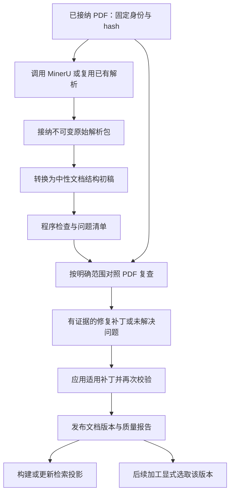
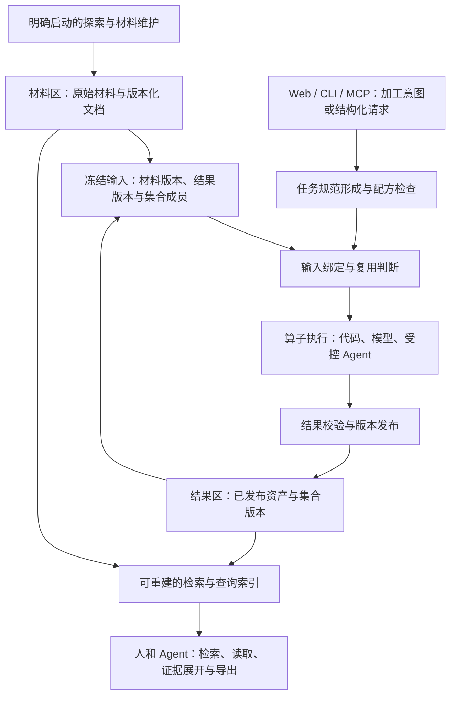

+++
document_type = "proposal"
status = "under-review"
created = "2026-10-17"
+++

# SciRetriever 文献知识加工平台提案

> 副本说明：本文是 2026-10-17 平台提案在 Owner 决定首版精简之前的原文副本，作为[完整版设计](README.md)保存；原提案文件将按精简计划修订。

> 状态：待确认。本文整理产品方向、范围和逻辑架构，不是 Accepted ADR，也不表示相关能力已经实现。用户明确确认之后，再同步需求、适用 ADR 和具体设计；本文不授权代码重构、数据迁移或外部服务调用。

SciRetriever 拟从可核对的文献材料出发，提供可组合的内容加工能力，把单篇或一组文献转化为标签、结构化记录、知识整理、比较结果和综述等产物。产物长期保存、可以检索和继续加工；输入或要求变化时，复用仍然适用的工作，为需要更新的部分生成新版本。

平台的核心是**版本化内容资产、可组合算子、输入与证据依赖、明确的更新策略**。逐篇结果可以按需组合，整体汇总也可以作为独立产物重新生成。增量的承诺是复用能够安全复用的工作，不是保证任何任务都只计算新增部分。

## 1. 要解决的问题与目标

研究者或 Agent 使用文献库时，应当主要描述文献范围、问题或记录规范。材料读取、证据定位、批量执行、结果保存、复用与更新由平台承担，避免每个应用重新实现这些基础能力。

| 性质           | 目标行为                                                           |
| -------------- | ------------------------------------------------------------------ |
| 内容扩展性     | 新应用通常通过规范和算子组合表达；新算法或内容类型有明确接入位置   |
| 增量更新       | 区分未变、变化、新增和不再入选的输入；按操作实际依赖决定更新范围   |
| 可复用         | 已有产物可跨任务引用；相同处理可复用适用结果，不要求重新运行原配方 |
| 可检索         | 人与 Agent 都能找原文、记录和论断，按类型读取并追溯来源            |
| 可核对与纠错   | 输出有证据或派生依据；修正形成新版本，并能识别受影响的下游         |
| 可恢复与可观察 | 支持部分成功、重试、取消、恢复，显示覆盖、失败和实际成本           |
| 历史可审计     | 保留运行实际输入与输出；更新不悄悄改变旧报告的含义                 |

这里的“可信知识源”指忠实程度经过检查、仍有质量标记的原文表示，不表示论文中的科学结论已经被平台证明。

## 2. 范围与责任边界

### 2.1 平台承担的范围

1. **文献与材料基础**：保留统一文献身份、元数据、引用关系、PDF、SI 和来源；继续提供明确启动的发现、获取、导入与解析能力。
2. **可核对文档**：保存解析表示、结构单元、资源与位置映射；支持复查、修复和重新解析，形成可继续使用的文档版本。
3. **通用内容加工**：提供默认问答、标注、提取、整理、计算和综合策略，同时允许受控的代码、Agent 或外部生产者替换策略。
4. **产物托管**：保存记录集、报告和其他类型产物的内容、版本、证据、依赖与修订记录，供后续任务使用。
5. **执行与更新**：解释配方、选择适用输入、复用结果、执行缺失工作，并管理失败、成本和更新影响。
6. **读取与交付**：共享的查询、检索、证据展开、上下文读取与导出能力，供 Web、CLI、MCP 等入口使用。

本次提案覆盖“已有 PDF 经解析、整理和复查形成可用文档，再生成知识产物”的加工链。文档准备属于平台内部的材料加工配方，与后续知识加工共用执行与版本机制。发现、引用扩展、PDF 获取和 Browser 协作继续存在，其具体实现不在本提案中重设计。

### 2.2 使用者与下游承担的范围

使用者定义研究问题、记录含义、领域字段、纳入条件、可比规则及科学上是否接纳结果。平台可以协助起草规范和提出归一化建议，并执行通用单位换算，但不能把科学实体等价、测量基准或条件可比性默认为已成立。

平台支持形成和导出候选数据集；最终领域数据集的接纳、模型训练、预测与实验验证由下游承担。原文报告、模型推断、计算结果和人工判断需要可区分。

首版不以全局科学事实本体、全局实体图谱或自动科学发现为前提，也不承诺覆盖所有领域算法。受控算子扩展不等于允许任意上传脚本直接访问凭据、数据库或 Browser。

### 2.3 材料准备、内容加工和纯读取

文献库在逻辑上区分两个区，仍共享一个统一的文献身份与 catalog，不要求拆成两个数据库：

| 区域   | 保存内容                                               | 写入方式                                          |
| ------ | ------------------------------------------------------ | ------------------------------------------------- |
| 材料区 | 文献身份、元数据、引用、PDF/SI、解析与修复后的文档表示 | 明确启动的探索或材料维护操作，由各业务 owner 写入 |
| 结果区 | 规范、配方、运行、标签、记录、报告、证据依赖与人工修正 | 明确启动的使用与加工操作，由相应产物 owner 写入   |

检索索引是上述内容的派生表示，可以重建，不成为第二套文献事实。材料区表示库里实际保留的来源，不意味着内容绝对正确。

使用任务读取固定版本的材料及既有结果，发现缺口时报告缺口，不隐式下载、加文献、解析或修复原文。用户决定是否启动材料补充，以及是否在新输入上更新结果；探索完成也不会自动触发分析。材料加工与知识加工共用引擎，但入口、允许的写入范围和发布 owner 分别明确，不因使用同一套算子机制而获得对方的写入权限。

纯检索和阅读保持只读；导出不修改库内事实，但明确交付文件这一副作用。生成答案、提取或综合是明确的加工操作，可以在选定范围内执行配方并写入结果。人类与 Agent 共用这些副作用边界。

## 3. 内容模型

以下是逻辑概念，不是已经冻结的接口或数据库表结构。本文“内容资产”包含材料和加工产物，不直接改名或替换现有代码中的 Asset 合同。

| 对象            | 含义                                                                           |
| --------------- | ------------------------------------------------------------------------------ |
| 文档包 Document | 某版本原始材料的可读表示：Markdown、图片等资源、结构与位置映射、解析及复查信息 |
| 结构单元 Unit   | 文档版本内可定位的段落、表格、图、公式等；作为读取与证据锚点                   |
| 内容条目 Item   | 可以独立引用的内容及其版本，例如一份逐篇提取结果、一条记录或一份整体报告       |
| 集合 Collection | 按确定范围组织的条目引用及其版本，保存成员、选取规则与覆盖说明                 |
| 内容资产 Asset  | 值得发布、长期保存、检索和复用的条目或集合，拥有稳定的逻辑身份与不可变版本     |
| 算子 Operator   | 输入到输出的加工合同及实现，包含方法、规范、执行粒度和更新能力                 |
| 配方 Recipe     | 为获得目标产物而组合的算子及资产引用，具有版本                                 |
| 运行 Run        | 配方的一次实际执行，记录固定输入、实际依赖、尝试、输出、失败和成本             |

资产统一身份、类型、版本、来源、依赖、证据和质量信息；正文结构由版本化类型或任务规范决定。记录保留字段和嵌套关系，报告保留 Markdown 正文和可定位引用，曲线保留坐标轴、单位及数据点。统一外壳不要求把全部内容压成同一种表格。

任务规范 TaskSpec 表达使用者要什么：范围规则、研究问题、记录含义、字段/比较要求、输出形式及完成标准。它与配方的处理步骤、本次运行固定的输入和执行配置分别保存；自然语言、表单与程序接口共同形成这一规范。

集合是组合与范围管理的主要方式。一份整体报告仍可作为单个内容条目保存，不要求为了复用而强行拆成逐篇段落。文献库可以作为默认的文献集合视图，派生标签和答案以可选列关联展示，不写成文献的权威来源事实。

同一篇文献可以有多个问题分析、多个提取规范和多个产物版本，不设唯一的“已经分析过”标记。任何任务都可以直接读取原文，不必先生成或消费一份通用摘要。

### 3.1 文档包与 Unit

PDF 转成 Markdown 的价值是建立便于检索、定位与模型处理的表示；PDF 二进制格式本身不等于不能检索。原始材料、初始解析和修复版本均保留。

文档复查 Agent 根据 PDF 页面及相关材料检查解析，输出修改建议或有出处的补丁，再经校验发布新文档版本；未解决问题继续标明。跨段、跨页或表格重构可以影响多个 Unit，不能假定修复永远局限于单个单元。

Unit 的身份、内容哈希、证据粒度和计算粒度分别表达：

- 相同文字出现在不同论文或位置时，证据身份不同；字节去重不能合并来源。
- 一个单元格的解释可能依赖表头、脚注和正文，读取与计算要携带这些上下文。
- 单元拆分、合并或重新编号时保存版本对应关系或明确无法匹配，不静默移动旧证据。
- 证据定位如实标注页、区域、逻辑单元格或精确框。首个闭环可支持“原 PDF 整表区域 + 解析表逻辑单元格及表头脚注”，不把逻辑单元格冒充精确 PDF 单元格坐标。

首个闭环可从已经复查的文档包开始，同时验证至少一次修复产生新版本后的更新行为。任务明确所需输入质量，未达到时报告缺口；不要求全库完成同一级复查后才能使用已满足条件的文献。全面自动修复的质量不作为“已提供统一文档包”的默认保证。

### 3.2 从 MinerU 输出到可用文档的材料加工配方

文档准备是一条正式加工配方。它接受已接纳且版本固定的 PDF 及其解析输出，发布下游可以读取、定位和核对的文档版本。与记录提取、综述等配方共享调度、依赖、复用、失败记录和不可变发布机制；具体解析协议、质量规则和写入责任由材料模块掌握。



调用解析、复查和发布都在用户已启动的材料任务范围内执行，不需要逐页重复确认；配置了哪些步骤、复查到哪里和实际完成多少均需可见。下游知识加工不因文档完成而自动启动。

| 步骤         | 处理内容                                                                                        | 输出与边界                                                                                  |
| ------------ | ----------------------------------------------------------------------------------------------- | ------------------------------------------------------------------------------------------- |
| 解析输出接纳 | 绑定原 PDF hash、解析器/adapter 版本与参数；检查输出包、文件引用、页索引及实际返回材料          | 保存不可变原始解析包或等价的完整输出集合，作为重新转换和复查依据；解析成功不等于内容正确    |
| 中性结构转换 | 整理章节、段落、阅读顺序、表格网格、图/公式、图表说明与脚注；转换页坐标与资源引用               | 形成版本化结构初稿及位置映射；供应商 JSON 留在 adapter 边界，不要求下游理解 MinerU 私有字段 |
| 程序检查     | 检查结构合法性、资源可达、位置范围、表格跨度及关联完整性；标记疑似重复、漏项或异常内容          | 技术检查结果和问题清单；页数相同、结构合法不能证明没有漏文或数值错误                        |
| 原文复查     | Agent 读取 PDF 页面或区域，与结构初稿对照，检查多栏顺序、漏段、数值符号、上下标、公式和表格对应 | 有原文位置依据的修复建议及实际复查覆盖；不能仅看 Markdown 自洽性                            |
| 修复与复验   | 对固定初稿应用替换、补入、拆分、合并等补丁，重建受影响结构与关联并复验                          | 新候选表示、修改记录与未解决问题；没有原文依据时不猜值，不用模型常识补写论文内容            |
| 版本发布     | 材料 owner 检查输入绑定、结构完整性和质量说明后发布，按明确规则选择默认版本                     | 可引用的 DocumentVersion；保留原 PDF、原始解析、旧表示及修复来源                            |
| 检索投影     | 根据已发布版本生成全文/语义索引与检索分块                                                       | 索引关联精确文档版本，可独立重建；索引失败不撤销有效文档，也不能假装检索完整                |

中性结构作为规范化的逻辑表示，Markdown 是其面向阅读和模型输入的投影，两者在同一文档版本中保持一致。修复经同一变换更新结构、Markdown 和位置映射，不能让手改 Markdown 与结构各自成为一份真相。具体结构 schema 留待设计。

修复补丁绑定基线文档版本/hash、目标单元或区域、修改前内容、建议值、理由和原 PDF 证据。应用前验证基线和目标仍然匹配；补丁失效或结构校验失败时不发布半套结果。跨页表格可以关联多个原文区域，不能为统一逻辑表伪造一个覆盖所有页面的坐标框。

Unit 负责来源结构和证据定位；适应不同检索或模型上下文长度的 chunk 是派生读取单元。调整 chunk 大小不应重新定义原文证据身份，也不要求重新解析 PDF。

主文与各份 SI 分别保存来源和文档版本，再在材料清单中关联。不同格式或尚未取得的 SI 如实声明能力与缺口，不无条件拼成一篇正文，也不通过该配方自行下载缺失材料。

### 3.3 可用文档的交付合同

材料配方交付的是一个带质量说明的文档版本，而不仅是清洗后的 Markdown：

- **内容与结构**：Markdown、章节/单元、表格网格及说明、图片/公式等实际可用资源。
- **定位与出处**：源文件身份/hash、PDF 页及区域映射、版本内单元引用、解析器与转换方法来源。
- **修订与对应**：原始解析引用、修改补丁、前后版本或单元对应；不能可靠匹配时明确冲突。
- **质量与覆盖**：检查方法、实际覆盖页面/区域/单元、发现和修复的问题、未解决项及能力缺口。

“可用”按任务要求判断，不设一个掩盖差异的全局完成标记。正文可检索但某张表无法可靠还原时，可以支持正文阅读，并向需要该表的提取任务报告缺口；缺少精确单元格框时，仍可交付整表区域和逻辑行列定位。

复查可以按明确策略覆盖疑点、指定区域或全文，必须保留实际范围。只检查疑点不能标为全文复查；“未发现问题”也不等于“所有内容正确”。面向源页面的核查还需要检查初稿中完全缺失的内容，不能只遍历已经抽出的 Unit。

原文忠实度与科研判断分开。此阶段不生成主题标签、摘要、实体归并或领域记录，不为方便统计而改写原始数值和单位。修复原文转写错误可以在依据充分时执行；论文自身可能写错的内容保留原样并标注疑问，不能用知识推断替作者改写。

关键字节、结构或引用损坏时不发布可用表示；存在可定位但尚未解决的局部内容问题时，可以发布带缺口的版本，由具体任务判断是否适用。复查失败保留原始解析和已完成的检查，但不冒充复查完成；后续失败不撤销已接纳 PDF 或旧有效版本。人工复核是可选处理方式，不因一处不确定而将全库挂起。

### 3.4 材料加工的更新与当前实现差距

材料配方的每一步独立记录输入和方法，更新只推进实际需要变化的步骤：

| 变化                                 | 预期处理                                                                             |
| ------------------------------------ | ------------------------------------------------------------------------------------ |
| 中性结构转换规则改变，原始解析仍适用 | 复用解析包，重新转换和检查；复查结果是否适用按依赖判断                               |
| 复查方法或修复策略改变               | 复用 PDF 与适用初稿，产生新检查记录或修复版本，不默认再次调用 MinerU                 |
| 一处数值、表格或阅读顺序被修复       | 复验相关上下文和引用，发布新文档版本；按下游实际依赖标注影响，不承诺只重算一个单元格 |
| 补入 SI                              | 主文版本保留，处理新增材料并形成新材料范围；此前相关“未找到”结果需要重新检查         |
| 解析器改变并明确要求重解析           | 生成新的原始解析和表示版本，保留旧链路；不悄悄迁移已有任务输入                       |
| 分块或索引方法改变                   | 只重建相应投影；源文档版本和历史证据保持不变                                         |

截至本次源码核对，项目使用 MinerU release 3.4.4、protocol 2 的固定 profile。adapter 已检查 middle/content-list 等输出，但发布的中性结果主要保留 Markdown 及其引用资源；文档 builder 仍以标题和逐行文本片段构造结构。现有实现尚不等于上述文档准备链。相关位置见 [MinerU 输出转换](../../../apps/server/src/parsing/backends/mineru/archive.ts)、[文档 builder](../../../apps/server/src/document/builder.ts)。

拟补齐的重点是原始布局输出保留、parser-neutral 结构和坐标转换、源页面复查与补丁、质量覆盖及发布关联。MinerU 不同输出文件的坐标尺度、页索引与旋转约定不能直接混用，转换规则须绑定实际版本；参考[固定版本输出说明](https://github.com/opendatalab/MinerU/blob/0dfc9460cd9ab693b9af60ae3fbffd7bc111b062/docs/en/reference/output_files.md)，不从新版协议推断当前字段。

历史解析若没有保留结构 JSON，不能承诺从 Markdown 无损恢复页码和坐标。需要定位能力的任务先报告缺口，再由明确材料任务决定是否重解析；已有文档和下游引用不因新合同而自动覆盖或失效。

## 4. 逻辑架构与所有权



图中的箭头表示数据流，不表示材料变化或普通读取自动启动加工。返回结果区的回路表示跨运行复用，不是同一版本的循环依赖。材料与结果的快照之间由显式任务衔接。

| 逻辑责任           | 拥有的业务决定                                                   |
| ------------------ | ---------------------------------------------------------------- |
| 文献与材料维护     | 文献身份、材料接纳、解析/修复版本及其质量和位置映射              |
| 内容资产与集合管理 | 产物身份、版本发布、集合成员、人工修订和长期保留；不裁定科学真假 |
| 加工与更新规划     | 规范和配方解析、依赖与适用性判断、分区、复用和影响范围           |
| 执行调度与算子实现 | 任务尝试、取消/恢复、成本；各算子拥有自身算法和输出校验          |
| 检索与读取         | 可重建索引、查询投影、内容展开与预算化上下文；不隐式生成或扩库   |
| 共享基础设施       | 模型/Agent 执行、配置、凭据、网络准入、存储与日志                |

这些是责任边界，不要求一一新建目录、数据库或服务。材料准备配方与知识加工配方共用执行引擎，其入口分别规定允许的操作和发布 owner，不能由模型或用户配方中的任意字段自行提升写入范围。每项业务事实仍只有一个写入 owner；Storage 保存已确认结果，不自行决定身份、接纳或失效。人类与 Agent 通过共同应用接口访问，外部执行器不能直接写内部表。

配方描述的是计算依赖，不是科学事实关系。算子内部允许受控的多轮推理和检查；对外仍需交付明确输入、输出和运行记录。

## 5. 算子与组合方式

首版以少量可组合能力开始，不把算子名称做成永远封闭的功能清单。

| 能力           | 典型输入与输出                                   | 常见执行粒度        |
| -------------- | ------------------------------------------------ | ------------------- |
| 找与选择       | 文献/资产范围和条件 → 固定集合、排序后的内容引用 | 查询或集合          |
| 标注与问答     | 文档及问题 → 标签、答案或定向摘要                | 单篇或单条          |
| 联合提取       | 文档材料及记录规范 → 多条结构化候选及字段证据    | 一篇文献的记录集    |
| 确定性计算     | 已有记录 → 筛选、换算、连接、分组、统计及图表    | 单条、分组或集合    |
| 语义比较与归一 | 候选名称/记录/论断 → 映射或关系判断              | 候选组或有界条目对  |
| 综合与写作     | 一组文档或产物 → 整体 Markdown 或其他报告        | 一组或整个集合      |
| 校验与修复     | 内容及原始证据 → 检查结果、修订建议或新版本      | 一个或多个单元/文档 |
| 人工修正       | 已保存结果及修正理由 → 独立修订版本              | 条目或产物          |

原始文档表示的修复属于明确启动的材料维护，由材料 owner 发布；普通加工配方可以产生问题报告或修复建议，不因此获得材料写入权限。派生产物的修订由相应产物 owner 处理。

记录提取可以一次联合生成多个字段，不能默认逐格独立调用模型。规范定义“一行代表什么”，保留原文报告的测量粒度；重复测量是否聚合由规范决定，不自动合并。

每个算子的合同至少包括：

1. 接受的输入类型、规范与输出类型。
2. 方法/实现版本、实际模型配置与会影响结果的参数。
3. 执行粒度，以及逐篇、逐组、整体重做等更新能力。
4. 需要的上下文、材料范围和集合依赖。
5. 校验、覆盖、失败和成本的输出方式。

默认策略服务于开箱即用，调用方可以用其他实现替换。新增应用优先复用现有类型和算子；新算法增加实现；确有新内容形态时增加类型及读取/检索适配，继续复用版本、执行和证据能力。

首版配方可以用有序步骤、明确输入和既有资产引用表达组合，无需可视化 DAG 编辑器。任何 YAML 或 Agent 生成的配方都须经过同一合同检查，不直接变成任意代码执行权限。

### 5.1 从研究意图到可执行任务

平台拟提供自然语言、任务表单与结构化 API 三种入口。自然语言适合描述新问题，表单/模板适合重复任务，结构化规范适合 Agent、批量调用和精确复现；三者进入相同的规范、计划与执行机制，不要求人类先学会算子名称。

```text
自然语言 / 表单 / 结构化请求
          ↓
任务规范：范围、含义、要求和完成标准
          ↓
配方：选择现有能力并连接输入输出
          ↓
程序检查 + 本次输入冻结 + 复用规划
          ↓
可选小样 / 明确范围内的正式运行
          ↓
带证据、覆盖和运行记录的版本化产物
```

建议的职责划分如下：

| 环节           | 如何实现                                                                                 | 关键边界                                                             |
| -------------- | ---------------------------------------------------------------------------------------- | -------------------------------------------------------------------- |
| 解释意图       | 模型结合用户表达、当前选择、资产目录和能力说明起草 TaskSpec；表单/API 可直接给出明确字段 | 不凭模型记忆补造材料或字段值，不静默改变研究问题                     |
| 形成规范       | 把对象范围、记录粒度、字段定义、比较条件、缺失处理和交付要求显式表达                     | 影响研究含义的歧义需要澄清；一般展示方式可采用可见默认               |
| 组成配方       | 使用模板或由模型组合已经注册的算子，引用已有产物                                         | 模型生成的是受约束计划，不把任意生成脚本直接交给运行环境             |
| 执行前检查     | 程序验证类型、字段、算子能力、依赖关系、材料可用性和允许的副作用，再绑定实际版本         | 合法 JSON 或合法配方不代表科学解释正确；缺能力不能由模型虚构接口补齐 |
| 运行与产物检查 | 执行器完成调度、复用和恢复；业务算子检查实际结果的结构、证据和覆盖                       | 失败、缺材料和不可比结果如实交付，不偷偷换成更容易完成的任务         |

例如使用者提出“从这些文献提取空气暴露实验，比较不同包覆方法并写报告”，系统应形成可查看的任务说明：这次指哪些文献；一条记录代表什么；提取材料、包覆方法、温度、湿度、时长及指定性能指标；在什么条件下比较；输出记录集和有证据的报告。若“性能更好”没有明确指标，不能自行把电导率、循环寿命或成本混为一种排序依据。

规范确定后，配方可组合“选取材料 → 联合提取 → 结构和证据检查 → 换算/分组比较 → 综合报告 → 发布”。已有算子足够时无需新写专用程序；确实缺少曲线数字化、拟合或其他领域算法时，明确缺口，另行接入实现，不承诺任意自然语言需求都能自动完成。

计划摘要以范围、字段、步骤、复用情况、交付物和成本估算呈现；精确内部结构可供高级调用方展开。小样用于检验系统是否理解了任务以及实际材料是否支持提取，数量与选取方法按任务设置，不能把一次小样成功当作全量正确证明。

试跑与确认不成为每次执行的固定审批链。任务含义和执行范围已经明确授权时，可以直接执行；仅对无法可靠推断、会改变研究含义或扩大操作范围的事项提出必要问题。用户只要求起草或试跑时，不擅自全量运行；已经明确要求全量运行，也不因其中某一步较贵而重复确认。

保存用户原始表达、规范版本、配方版本与各次实际运行清单。再次运行既有任务默认沿用明确规范，不每次让模型重新解释；用户改变要求时形成可见修订。输入成员在每次运行开始时固定，不能在执行过程中把 50 篇悄悄变为 51 篇。执行中检查出的失败或能力缺口可以触发合同内的重试/恢复，但不能授权材料扩充或改变科学目标。

这是一种任务解释和计划形成能力，首版不要求自动搜索最优模型或任意生成代码。模板、类型检查与受控算子提供稳定执行基础，模型负责其中需要语言理解的部分。

## 6. 两类更新语义

### 6.1 逐篇可独立操作：按实际重叠复用

第一轮提取 100 篇，第二轮选中 120 篇，两轮重叠 80 篇。假设重叠文献的材料、规范、方法及相关依赖未变，且此前有满足本次要求的有效结果：

| 输入情况           | 数量 | 第二轮行为               |
| ------------------ | ---: | ------------------------ |
| 两轮重叠且结果适用 |   80 | 引用已有逐篇记录集       |
| 本轮新增           |   40 | 执行提取                 |
| 仅在上一轮入选     |   20 | 保留历史，不纳入本轮集合 |

本轮只执行 40 篇，结果集以本次 120 篇为范围。若重叠 80 篇中另有 5 篇材料发生变化，则复用 75 篇，重新处理 5 篇，加上新增 40 篇，共执行 45 篇。此前失败或覆盖不满足要求的输入也不能当作已成功复用。

本轮集合保存各篇产物的精确版本引用，不把所有记录复制后粘成不可拆分的一份。旧集合继续引用旧版本。集合仍是正式产物，可以独立查询、导出和作为下游输入；后续更新产生新集合版本。

匹配先依据文献身份及本次选定材料，再判断结果适用性，不能仅按集合大小差计算增量，也不能仅凭相同文字哈希复用带有不同来源的证据。

### 6.2 整体综合操作：允许整体重新加工

50 篇文献汇总为一份论述紧密关联的 Markdown；下一轮在相同主题下汇总原有 50 篇和新增的第 51 篇：

```text
50 篇的固定输入 → 综合运行一 → 汇总文档 v1
51 篇的固定输入 → 综合运行二 → 汇总文档 v2
```

v1 与 v2 都保留，分别绑定各自的输入清单。若是同一份汇总的更新，可沿用逻辑资产身份发布 v2；若研究目标不同，则可以发布另一份资产。

未变的清洗文档、适用的逐篇提取和分析可以复用；最后的综合步骤可能需要重新执行。新增论文可能改变总体结论，不能默认只在旧稿末尾添加内容。

执行策略可以利用旧稿修订，也可以重新组织全文；两者都要基于本轮范围，能够回查原始证据，并发布新版本。旧稿不能自动代替原有 50 篇的全部信息。树形汇总、局部修订或折叠可以作为后续优化，须验证覆盖和质量，不作为首版正确性的前提。

### 6.3 分组与跨篇操作

按固定条件分组时，可以只重算受影响的组；若组的定义、名称归并或整体聚类改变，则可能影响旧成员和多个组。算子要声明实际依赖，不能统一承诺“只比较新条目”。

集合变化本身只标注影响并准备更新说明，不因每次入库自动执行昂贵加工。用户明确发起更新后，平台在该任务范围内执行所需统计或整体综合，无需因步骤昂贵而重复确认；如果只请求刷新逐篇结果，则整体综合继续提示待更新。旧结果在旧输入下的历史身份不变，“待更新”是相对于新材料或新要求的提示。

## 7. 复用、依赖与正式产物

“结果复用”是平台能力，“缓存”是其中一种实现机制。模型请求缓存、运行检查点、逐篇产物复用、长期版本管理不能互相替代。

复用判断至少考虑输入内容与身份、方法/规范版本、实际执行配置、输出要求以及相关依赖。精确缓存键与实现算法留待设计，不以某框架默认缓存键充当产品合同。

依赖同时包括：

- 实际读取的文档、单元和上游产物版本；
- 材料范围，包括正文、SI、资源及缺失/未处理情况；
- 检索问题、查询范围、集合成员与影响选取结果的索引/方法版本。

例如，主文没变但补入 SI，或原先零命中的检索范围加入了新文献，都可能使旧答案需要重新检查。只记录已经读到的几个单元，无法保证更新正确。逐篇独立任务也不应无条件依赖整个文献库版本，避免无关入库导致全部重算。

模型重新执行不保证输出相同。复用表示选择已有的、满足要求的历史输出；显式重跑可生成新版本，并记录真实方法和执行来源。措辞近似或模型判断相似，不自动构成结果等价。

正式产物遵守不可覆盖发布和明确保留规则，缓存可以清理或重建。复用记录可以直接指向正式产物，不要求复制一份内容。缓存淘汰或输入退出当前集合，不得删除已发布历史或无声断开证据。

运行恢复还需要持久执行状态、输出完整性检查与安全发布，不能把“存在缓存”作为任务成功的唯一依据。

长期保留的重点是正式产物、其实际输入与方法清单、证据和必要覆盖信息。运行尝试与诊断按恢复及审计需要定义保留期，不因此永久托管所有探索报告、失败日志或完整模型会话。记录成本不重新引入现行固定输入解析、分析和综合已经取消的业务总预算；读取上下文预算保持独立语义。

## 8. 证据、修订与检索

**Evidence** 表达某个值或论断由哪里支持；**lineage** 表达内容经过什么加工、使用哪些输入版本形成。报告来自 51 份摘要属于 lineage，其中某个结论具体由哪些原文支持，需要单独的证据关联。跨篇推断可以关联多份证据和推理方法，不虚构一条直接陈述该推断的原文。

来源与加工链、执行状态、人工审阅状态和覆盖分别保存。执行完成不等于科学正确；格式合法或引文可定位不等于论断被证据充分支持。成功但未找到、材料未取得、已取得但未处理、执行失败应能区分。

人工修正保存旧值、新值、理由、产生者和原版本关系；生效后生成可引用的新版本。依赖反查说明哪些当前结果可能需要更新，不就地改写旧运行或替换所有历史引用。记录拆分、合并或身份匹配不确定时显式呈现，不能把新值静默填入错误的旧行。

平台同时检索原文和派生产物。记录支持结构化筛选，文档与论断支持全文/语义检索，其他类型提供适用的读取方式；不要求所有类型机械拥有同样的索引。结果返回类型、版本、来源、覆盖和可展开引用，避免同一证据在摘要、综述中重复出现后被计为多份独立证据。

## 9. 用户与 Agent 使用方式

Web 主要呈现资产、任务、证据和来源关系。用户可以选文献或既有产物，通过自然语言、模板或表单形成任务规范，查看处理说明后按实际意图起草、小样试跑或直接执行明确范围；遵循第 5.1 节的同一解释与检查机制。成本预览给出估算依据和范围，不保证复杂 Agent 的精确费用。

任务显示本次范围、复用/新执行/重做数量、失败、覆盖和实际成本。结果页支持版本查看、证据展开、人工修订、影响提示，以及在新范围上更新。逐篇集合与整体报告使用同一套版本和来源入口，保留各自合适的阅读方式。

MCP 与 CLI 分别覆盖上述 Web 业务能力，共用列出/描述资产、查询/读取、提交加工、查看运行和发起更新等应用语义。报告、记录集、上下文包与书目等可导出；下游依赖稳定 ID、类型与版本合同，不直接访问内部数据库表。

本文不改定导航或现有 Web 原型。配方在普通界面中可显示为步骤说明，高级调用方可使用经校验的结构化定义。

## 10. 建议的首版闭环与验收范围

首版建议覆盖：版本化文档包与基本证据、逐篇标注/问题分析/联合提取、确定性计算、集合级综合、正式产物与集合托管、复用判断、运行恢复、修订影响，以及共享读取接口和核心 Web 展示。

应用闭环可以复用已有检查后的文档；材料闭环另需覆盖从原始解析包到文档发布，并验证已知解析错误的发现、修复和证据定位。目标是证明可核对的准备流程，不以一次样本通过宣称具备全面自动修复能力。

复杂实体归并、全面自动文档修复、矛盾核查可以逐步扩展，不能成为所有阅读和提取的前置条件。首版不做通用 DAG 编辑器、自动模型/计划成本优化器、分布式执行或自研向量数据库。部署与框架仍按验证结果选择，不承诺仅凭“文献数”就能确定性能。

| 场景                          | 验收结果                                                                             |
| ----------------------------- | ------------------------------------------------------------------------------------ |
| MinerU 输出形成可用文档       | 保留原始解析，转换结构和位置，修复已知错误并发布新版本；未解决问题与实际复查范围可见 |
| 复查或索引阶段失败            | 保留原始材料和此前有效版本；不发布不一致补丁，也不把局部检查称为全文完成             |
| 同一批材料做问答和记录提取    | 共用读取、证据、执行与发布能力；产物可继续加工                                       |
| 100 篇改为 120 篇，重叠 80 篇 | 在依赖未变条件下复用 80 篇、处理 40 篇；旧集合独有的 20 篇不混入新集合               |
| 重叠文献有部分被修复          | 只按实际影响重做对应处理；历史文档与结果仍可读取                                     |
| 50 篇整体汇总更新到 51 篇     | 发布新整体文档版本，保留旧版，输入范围与证据可核对                                   |
| 新增 SI 或零命中范围新增证据  | 相关“未找到”结果能被识别为需要重新检查                                               |
| 改规范、换方法或人工改值      | 新旧结果可区分；不确定的记录匹配可见；下游影响可追踪                                 |
| 部分失败、取消或进程中断      | 保留已发布有效结果，明确缺口，恢复不产生冲突覆盖                                     |
| 清理执行缓存                  | 正式产物及其证据仍可读取；是否重算由运行策略决定                                     |
| 新增“实验条件比较”应用        | 主要新增规范/算法组合，不重复实现材料读取、证据和版本机制                            |

质量评价需要代表性材料与人工标注，分别看提取准确性、漏抽、证据支持、覆盖和更新正确性。30–50 篇可以作为初始样本规模，实际充分性与阈值由领域和任务决定，不能由数量本身保证。这个纵向闭环不替代现行 R6/R8 的万篇容量和长期运行验收；小样通过与规模交付分别报告。

任务入口还需验证：同一意图通过自然语言、表单和 API 表达时进入同一执行合同；一个此前没有专用脚本的新组合任务能复用已有能力完成；歧义、缺能力和仅试跑要求不会被误执行为另一个目标或全量任务。

## 11. 技术路线候选与现有基础

调研支持采用语义算子和增量资产的设计方向，但没有证明“全部自建更省”或“某个框架可直接承载整个产品”。2026-10-17 的官方文档与固定源码核查支持保留以下候选：

| 候选                                                                                             | 可比较的价值                                         | 必须验证的差距                                      |
| ------------------------------------------------------------------------------------------------ | ---------------------------------------------------- | --------------------------------------------------- |
| [DocETL](https://github.com/ucbepic/docetl/tree/4bb086253767e2fd5a708776f9a1db1bdf79a2e0)        | 语义算子、配方、校验、Agent、持久请求缓存与检查点    | 输入变化感知、字段证据、长期资产版本与现有执行边界  |
| [LOTUS](https://github.com/lotus-data/lotus/tree/136ae4f4a344a2f75d89f811e516dfcb0de30e46)       | 表格语义处理、惰性执行、缓存、Corpus/Unit 与字段引文 | Unit 版本与 PDF 锚点、产物生命周期、跨运行更新      |
| [Palimpzest](https://github.com/mitdbg/palimpzest/tree/807ed301c4d2457ef304647e6095184556bd1e83) | 声明式执行与质量/成本优化、记录来源                  | 精确证据与长期版本管理；优化器并非首版必要范围      |
| [CocoIndex v1.0.25](https://github.com/cocoindex-io/cocoindex/tree/v1.0.25)                      | 持久增量执行、依赖与派生目标同步                     | 默认目标覆盖/删除与历史资产保留不同，需限制写入责任 |
| 现有 TypeScript 底座上的薄实现                                                                   | 复用当前运行、模型与存储边界，减少额外运行时         | 要自行补齐的依赖、更新、验证工作量和维护成本        |

这些候选可以承担不同层次，不必整体二选一。Python/Rust worker 的接入成本需要测量，语言差异本身不能决定采用或排除。

当前已有持久任务、输入清单、知识产物发布、DSH 模型/Agent 基础和材料/知识检索，可作为实施比较的起点；精确 Unit、通用记录产物托管、依赖更新与修订传播仍有缺口。目标不受当前目录形状限制，具体复用或重构在实施阶段决定。

框架试接应使用同一组增删改、补 SI、取消恢复和版本保留场景，比较正确性、适配代码量、部署与长期维护成本。试验不能让框架自己的模型 transport、目标写入或自动删除绕过项目的执行、网络与发布边界。

不采用固定月数作为本提案承诺。工期需依据首版验收范围、证据质量和候选接入验证重新估算。

## 12. 与现行合同的关系及待定问题

本文提出的目标尚不改变当前已接受合同或发布行为：

其中，原始解析包的留存拟调整 ADR 0010 第 5 节现行“解析结束后清理私有过程文件”的策略。保存范围应服务于已接纳文档的转换、核对与修复，不等于永久保留全部失败尝试；私有辅助输出仍由 adapter 管理，不直接变成公共 ParserResult 字段。该变化与精确保留清单一并等待确认。

| 主题                                                                                                    | 提案关系                                                                                                                   |
| ------------------------------------------------------------------------------------------------------- | -------------------------------------------------------------------------------------------------------------------------- |
| [R13 与 ADR 0027](../../architecture/decisions/0027-extraction-capabilities-and-caller-defined-records.md) | 拟明确提供默认提取执行与长期候选托管，需在确认后补充其责任和产物合同；领域含义与最终接纳继续归调用方                       |
| [R9 与 ADR 0010](../../archive/decisions/0010-parser-neutral-markdown-current-result.md)              | 拟扩展文档复查、Unit 与位置映射，需设计版本和兼容；保持原始材料与 parser-neutral 边界                                      |
| [ADR 0011](../../architecture/decisions/0011-literature-database-centered-incremental-maintenance.md)      | 新结果集合是统一文献库之上的派生产物；不复制文献身份或形成第二套事实库，持久集合合同需明确                                 |
| [ADR 0028](../../architecture/decisions/0028-query-and-expansion-separation.md)                            | 保持查询、材料扩充和显式加工边界；新配方不获得隐式补库权限                                                                 |
| [ADR 0031](../../architecture/decisions/0031-dsh-backed-agent-capabilities.md)                             | 当前 DSH/Agents 及配置、网络边界保持；外部算子框架须适配，若确需改变则另行提出                                             |
| [ADR 0032](../../architecture/decisions/0032-library-centered-web-workspace.md)                            | 保留文献库主空间及独立页面基准；持久结果集合、派生标签和版本面板是拟扩展，不把既有查询视图或原型当成这些合同已获批准的依据 |
| [ADR 0033](../../architecture/decisions/0033-machine-interfaces-cover-web-capabilities.md)                 | 保持 CLI 与 MCP 分别覆盖 Web 业务能力，共用稳定资产与操作合同                                                              |

进入精确规格前仍需收敛：

1. 中性文档结构、Unit、记录及整体报告内部引用的标识与跨版本对应规则，尤其表格重构和记录拆分/合并。
2. 算子合同、动态依赖与材料/查询范围的表达，哪些类型可以安全细分更新。
3. 产物发布、默认版本选择、人工修订和保留规则的具体接口。
4. 外部框架与现有执行底座的适配路线，以及首版质量评价和验收阈值。
5. 材料配方默认复查哪些范围、采用什么质量要求，以及原始解析辅助文件的具体保留清单。
6. 自然语言任务解释的默认模板、需要澄清的语义边界，以及意图与计划一致性的评价方法。

方向确认后，再把这些问题转成精确合同与实施计划。当前提案保留两条同等有效的路径：**逐篇结果独立保存并组合复用；整体知识产物根据新输入重新加工并发布新版本。**

[提案导航](../README.md) · [文档导航](../../README.md) · [产品需求](../../architecture/requirements.md)
